# STM32移植uC/OS——RTOS多任务实战

## 0 前言

本博客为大家详细介绍RTOS借助内核调度实现多个任务并行运行。基于STM32F103C8T6，记录uC/OS移植与多任务构。同时学习I2C总线通信协议，驱动 AHT20 完成温湿度采集，并将采集功能集成到RTOS任务中，结合波形观测解析I2C协议。

[Toc]

---

## 1介绍原理

### 1.1 认识uC/OS分层架构

uC/OS‑III 是抢占式实时内核，分层架构的设计，把内核逻辑、处理器硬件代码、用户应用代码相互隔离。内核主体不绑定芯片，只需要修改最底层适配层，就能快速移植到不同架构 CPU。

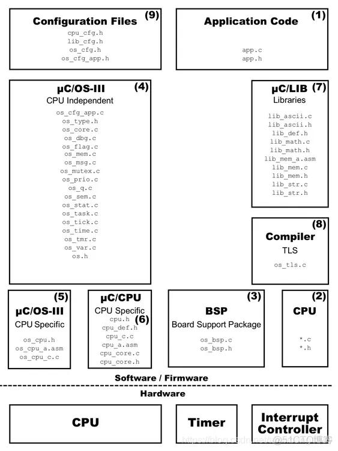

最上层为应用层，本次实验的 LED 控制、AHT20 采集、串口输出任务都在此实现，直接调用内核 API 开发业务。内核服务层，是纯C语言实现的通用内核，负责任务管理、抢占调度、时间管理与任务间同步通信，移植全程不需要修改这部分源码。Port 处理器适配层是移植工作的核心，衔接内核与 Cortex‑M3 架构，包含上下文切换、中断控制等底层适配代码。最底层是硬件层，依托 STM32 芯片本身，SysTick 提供系统节拍，PendSV 负责完成任务切换，GPIO、I2C、串口等外设由 CubeMX 搭配 HAL 库完成配置。

分层设计实现软硬件解耦，更换 MCU 时只需重新适配 Port 层，上层业务代码大多可以复用。很多初学者容易走入误区，尝试修改内核源码，实际上 uC/OS 移植的本质，就是完成 Port 层和目标硬件的适配对接。

### 1.2区分硬件与软件I2C

🔷物理层：两根开漏线

I2C 总线一共就两根信号线，SCL 是时钟线，由主机负责输出时钟,SDA 为双向数据线，主机和从机分时驱动。两根引脚都要配置成开漏模式，搭配上拉电阻工作。总线的逻辑是线与机制：只要任意一个设备把引脚拉低，总线就为低电平；全部释放之后，总线依靠上拉电阻回到高电平。这样设计可以避免多个器件同时驱动总线造成短路，也支持多主机仲裁和时钟拉伸。

STM32F1 芯片内部的开漏上拉能力很弱，AHT20 模块出厂一般自带 4.7k 上拉电阻，如果直接用裸芯片搭建电路，就必须外部添加上拉电阻。

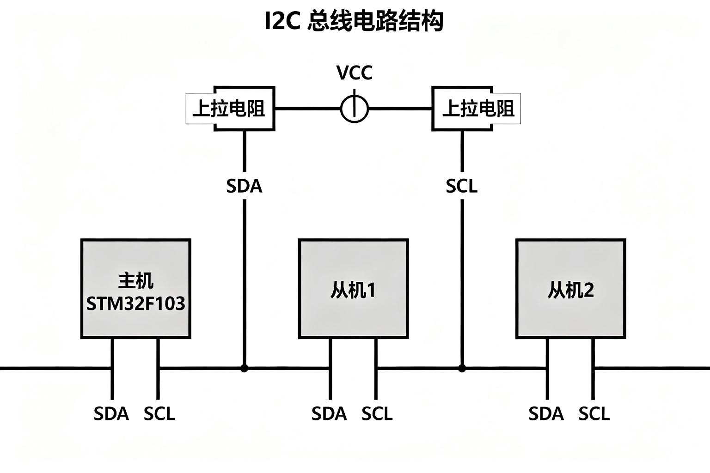

🔷协议层

I2C 依靠几个基础信号完成通信：起始信号 START，是 SCL 保持高电平的时候，SDA 由高变低,停止信号 STOP，则是 SCL 高电平期间 SDA 从低拉高。数据传输有一条核心规则：SCL 为低的时候才能改动 SDA 电平，SCL 拉高时 SDA 电平必须稳定，供从机采样。每发送完一个字节，第 9 个时钟用来接收应答位 ACK，从机如果正常收到数据，会把 SDA 拉低作为应答。

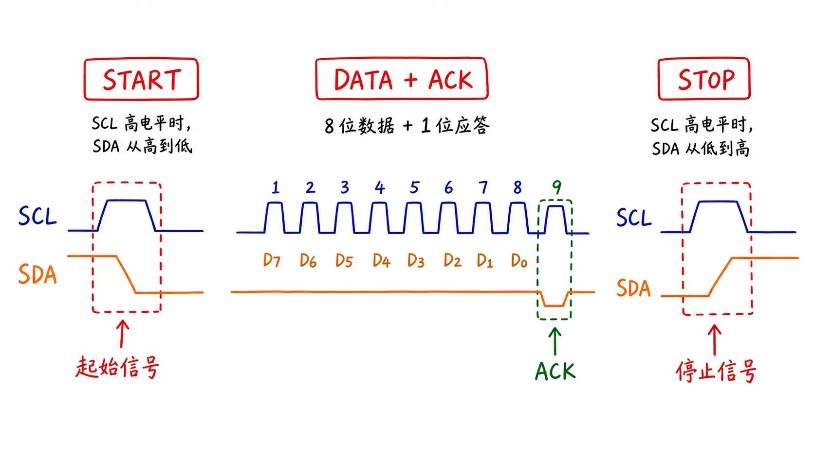

通信第一个字节由 7 位从机地址加上读写位组成。AHT20 的 7 位从机地址是 0x38，写操作时地址左移一位得到 0x70，读操作就是 0x71。这里很容易踩坑，不少同学直接把 0x38 当成 8 位地址发送，从机识别不到，自然不会产生应答。

🔷 软件 I2C

软件 I2C 也就是常说的位模拟，不使用芯片自带的 I2C 外设，随便拿两个普通 GPIO 配置成开漏输出，靠代码延时翻转引脚电平，手动模拟出 SCL、SDA 的时序。

```
void I2C_Start(void)
{
    SDA_H();  SCL_H();  Delay();
    SDA_L();
    Delay();  SCL_L();  Delay();
}
uint8_t I2C_WriteByte(uint8_t data)
{
    uint8_t i, ack;
    for (i = 0; i < 8; i++) {
        if (data & 0x80) SDA_H(); else SDA_L();
        data <<= 1;
        Delay();  SCL_H();  Delay();
        SCL_L();  Delay();
    }
    SDA_H();  Delay();  SCL_H();  Delay();
    ack = SDA_READ();
    SCL_L();  Delay();
    return ack;
}
```

它的好处很实在，引脚选择灵活，换板子不用纠结外设映射；时序完全自己把控，适配一些对时序敏感的传感器；还能避开 STM32F1 硬件 I2C 经典的 BUSY 死锁 bug。代码逻辑直白，每一行都对应 I2C 协议动作，很适合学习和调试。缺点也很明显，发送过程靠延时等待，CPU 一直被占用，常规速率大多在 100~400kHz，想要实现多主机仲裁、时钟拉伸这些功能，代码写起来会比较麻烦。

🔷 硬件 I2C

硬件 I2C 调用 STM32 内部集成的 I2C 外设，我们只需要给寄存器写入从机地址、数据和读写方向，起始信号、时钟、移位、应答、停止信号全部由外设硬件自动生成。

```
uint8_t cmd[3] = {0xAC, 0x33, 0x00};
HAL_I2C_Master_Transmit(&hi2c1, 0x38 << 1, cmd, 3, 100);
HAL_I2C_Master_Receive(&hi2c1, (0x38 << 1) | 1, buf, 7, 100);
```

硬件 I2C 最大优势就是解放 CPU，传输稳定，还支持中断、DMA。短板是引脚固定，I2C1 只能用指定引脚或者重映射；配置门槛偏高，加上 F1 系列硬件 I2C 本身存在手册标注的 bug，项目里很容易遇到总线卡死。

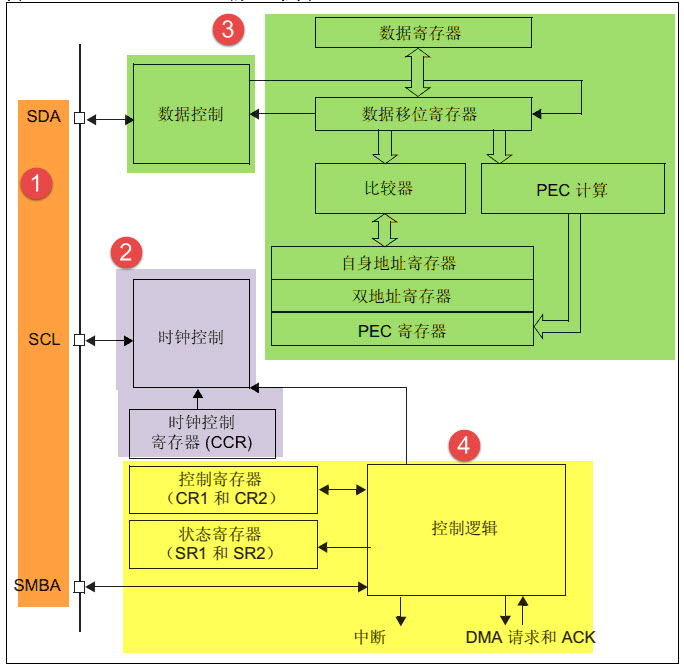

🔷对比与选择

软件 I2C 用普通 GPIO，引脚随便选，CPU 占用高，但是调试简单，不容易触发 F1 的硬件 bug；硬件 I2C 占用专用 I2C 外设，引脚固定，CPU 负担小，但是 F1 平台容易出现总线锁死。

这次实验最终选用软件I2C驱动 AHT20。这个场景只有一个主机，传感器速率不高，并用示波器采集波形分析时序协议。

### 1.3初识AHT20

🔷基本参数

AHT20 支持 2.2~5.5V 供电，我们实验里直接用 3.3V 供电；通信接口是 I2C，最高支持 400kHz。测温范围 - 40~85℃，典型精度 ±0.3℃；湿度测量范围 0~100% RH，精度 ±2% RH。温湿度的分辨率分别可以达到 0.01℃、0.024% RH，单次测量转换大概需要 80ms，上电之后至少要等 40ms 才能正常操作。

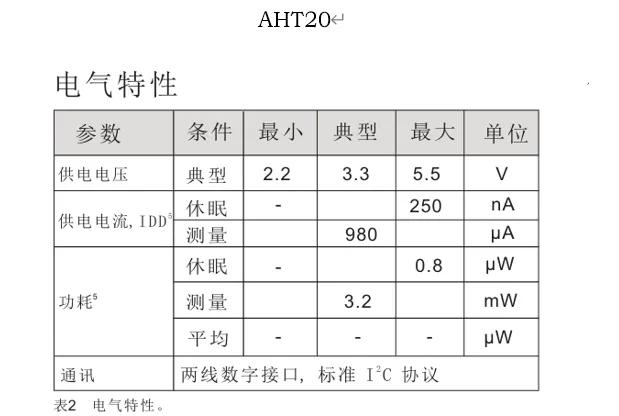

🔷 地址

它的 7 位从机地址固定是 0x38，放到 I2C 总线传输时需要拼接读写位：写指令时 8 位地址为 0x70，读取数据时 8 位地址为 0x71。

🔷状态字节

读取到的状态字节里，bit7 是忙标志 BUSY，置 1 代表传感器正在进行测量；bit6、bit5 为模式位；bit3 是 CAL 校准标志，为 1 代表传感器已经完成校准，其余位是保留位。 初始化的时候我们会先读一次状态，如果 `status & 0x08 == 0`，说明还没有校准，需要发送校准命令。

🔷命令表

常用命令一共三组：校准命令0xBE 0x08 0x00，发送之后等待 10ms；触发测量命令 0xAC 0x33 0x00，发送完等待约 80ms 等待转换完成；软复位命令 0xBA，复位后至少等待 20ms，本次实验没有用到复位。

初始化流程：先发起起始信号，发送读地址 0x71，读取状态字节；如果 CAL 标志位为 0，就发送起始、写地址 0x70、校准三字节命令，之后停止总线并延时 10ms；如果 CAL 标志已经为 1，就跳过校准步骤，直接进入测量。 测量流程：发送起始信号、写地址 0x70 和测量命令，停止总线；等待 80ms 转换；再次发起起始信号、读地址 0x71，连续读取 7 个字节，最后一字节回复 NACK，结束通信。

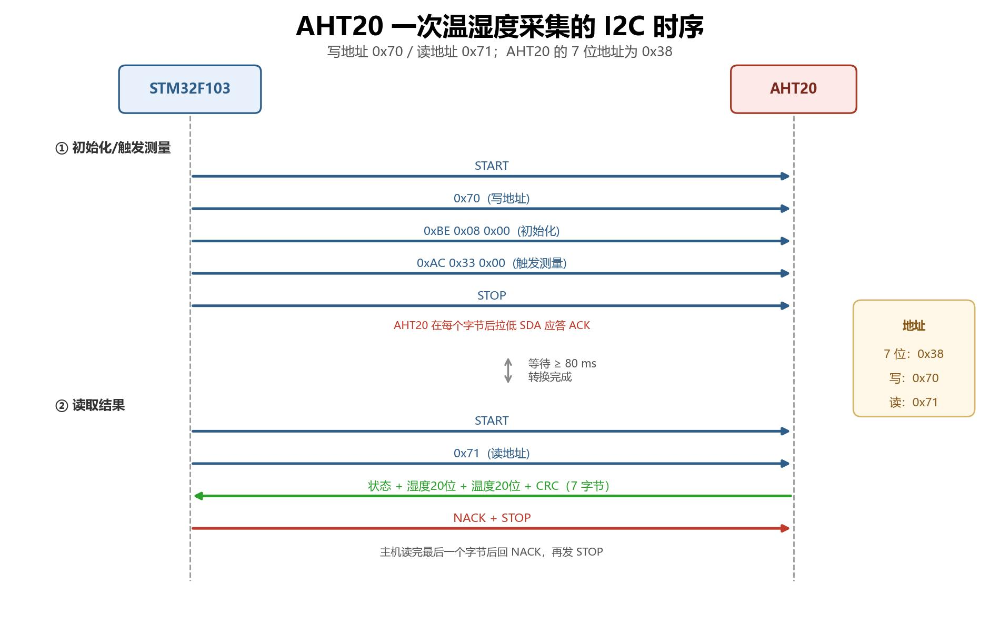

🔷数据帧与换算

一次读取一共 7 个字节，第 0 字节是状态，1~3 字节存放湿度原始数据，3~5 字节存放温度原始数据，最后第 6 字节是 CRC8 校验值。

```
rawH = ((uint32_t)buf[1] << 12) |
       ((uint32_t)buf[2] << 4)  |
       ((uint32_t)buf[3] >> 4);

rawT = (((uint32_t)buf[3] & 0x0F) << 16) |
        ((uint32_t)buf[4] << 8) |
        ((uint32_t)buf[5]);

RH = rawH / 1048576.0f * 100.0f;
T  = rawT / 1048576.0f * 200.0f - 50.0f;
```

CRC8 校验采用多项式 0x31，初始值 0xFF，用来校验前面 6 个字节的数据，用来判断数据有没有在传输过程出错。

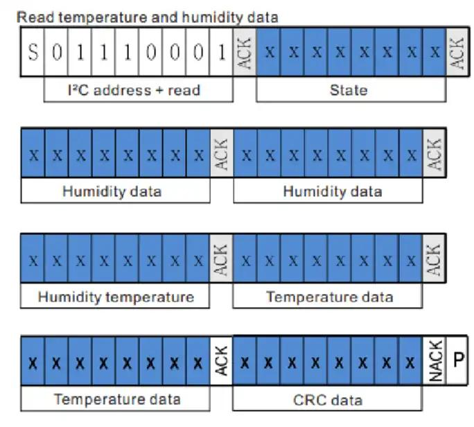

---

## 2任务一：uC/OS移植与多任务调度

### 2.1搭建基础工程

🔷选择STM32F103芯片，配置好RCC与SYS基础配置

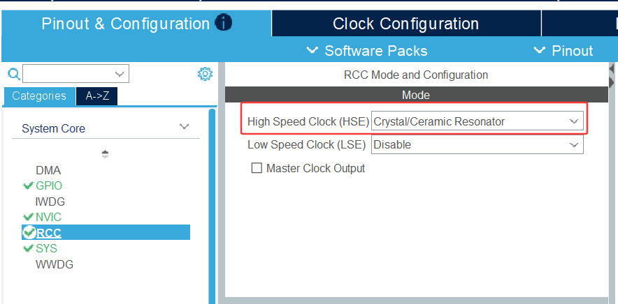

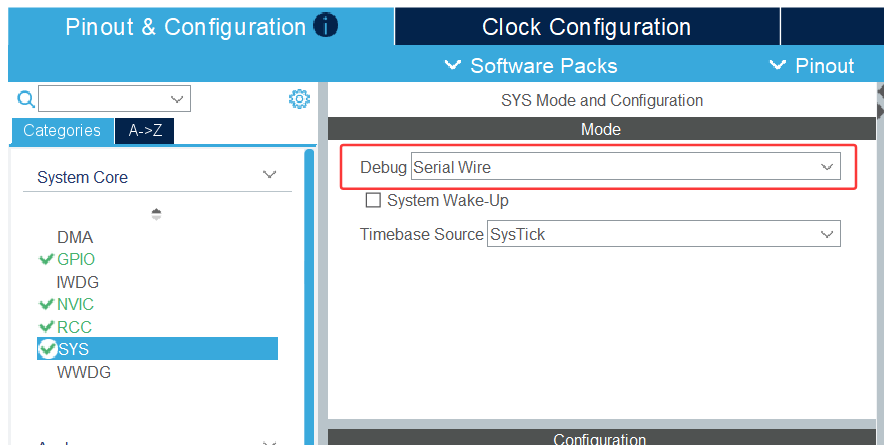

🔷其次配置系统时钟，选择择HSE外部高速晶振与PLL 倍频配置，最终系统时钟输出 72MHz。

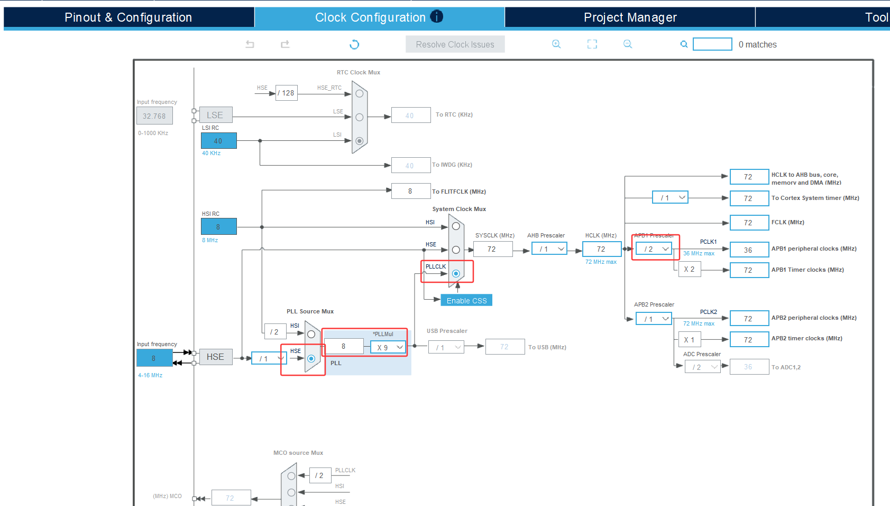

🔷TIM4 OS 节拍

CubeMX 本身并不感知 uC/OS，我们将 TIM4 时钟源选择内部时钟，预分频设置为 71，计数周期设置为 999，开启 TIM4 全局中断并把 NVIC 优先级配置为 15，以此得到 1kHz 的定时初始化代码。

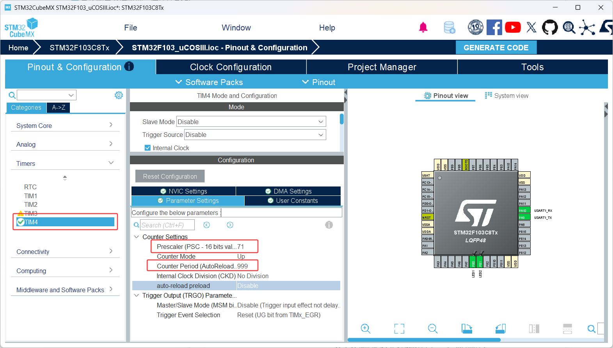

🔷设置PB0、PB1为LED1、LED2，并设置下拉电阻，高电平点亮。

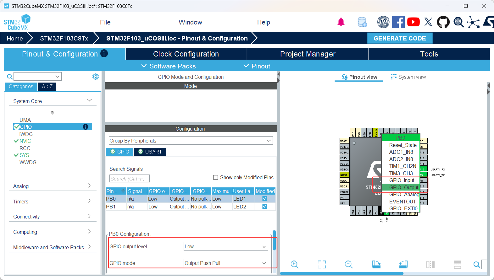

🔷最后生成工程

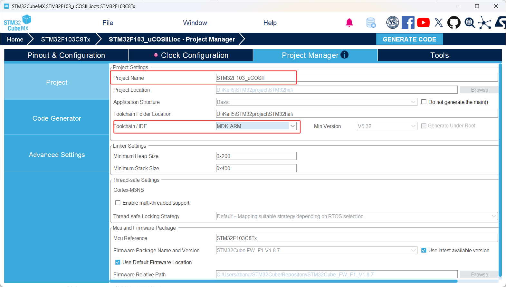

---

### 2.2 keil工程代码完善

🔷 添加源码

所需文件包含uC‑OS3内核本体 Source 目录下 源码以及os.h、os_type.h、os_trace.h；uC‑CPU处理器抽象层的cpu_core.c、cpu_def.h、cpu_cache.h、ARM‑Cortex‑M架构下ARMv7‑M的cpu.h、cpu_a.asm和cpu_cfg.h；还有uC‑LIB库提供基础宏、内存与字符串相关的lib_def.h、lib_mem.h、lib_str.h等头文件。

把上述几个包分别放到该文件夹：

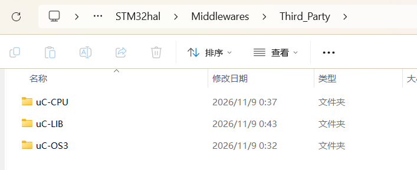

🔷Keil 工程分组

在 Keil中建 6 个 Group：包含启动文件、用户业务代码、板级驱动与中断相关文件，STM32F1 的 HAL 驱动源码，uC‑OS3 内核源码、CPU 抽象层文件以及 uC‑OS3 对应 Cortex‑M3 的移植文件。

> 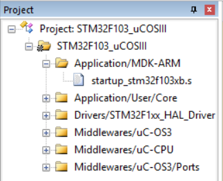

🔷Include Paths与宏

打开工程的Options for Target，依次配置头文件路径、预定义宏、编译选项以及编译器版本V5。

🔷 启动文件：PendSV 向量改名

Cortex-M3 的上下文切换由 PendSV 异常完成。os_cpu_a.asm 导出的函数名是 OS_CPU_PendSVHandler，而 ST 启动文件里的弱定义叫 PendSV_Handler。两者不一致，链接后向量表里仍然是空函数，第一次任务切换就 HardFault。

把所有 PendSV_Handler 替换为 OS_CPU_PendSVHandler：

```asm
DCD     OS_CPU_PendSVHandler       ; PendSV Handler
OS_CPU_PendSVHandler  PROC
                EXPORT  OS_CPU_PendSVHandler       [WEAK]
```

🔷补写 os_cpu_c.c：任务初始栈帧

V3.08 的端口目录只有 os_cpu.h 和 os_cpu_a.asm，没有 os_cpu_c.c，但内核链接时需要 OSTaskStkInit()。

Cortex-M3 异常入口时硬件自动压栈 8 个字：R0 R1 R2 R3 R12 LR PC xPSR，软件只需再保存 R4~R11 和 R14。所以初始栈应为：

```
R4 R5 R6 R7 R8 R9 R10 R11 R14 | R0 R1 R2 R3 R12 LR PC xPSR
```

```c
CPU_STK *OSTaskStkInit(OS_TASK_PTR p_task, void *p_arg,
                       CPU_STK *p_stk_base, CPU_STK *p_stk_limit,
                       CPU_STK_SIZE stk_size, OS_OPT opt)
{
    CPU_STK *p_stk;

    (void)opt;
    (void)p_stk_limit;

    p_stk = &p_stk_base[stk_size];
    p_stk = (CPU_STK *)((CPU_STK)(p_stk) & 0xFFFFFFF8u);   /* 8 字节对齐 */

    *(--p_stk) = (CPU_STK)0x01000000u;   /* xPSR，必须置 Thumb 位 T=1 */
    *(--p_stk) = (CPU_STK)p_task;        /* PC = 任务入口 */
    *(--p_stk) = (CPU_STK)0xFFFFFFFDu;   /* LR = EXC_RETURN */
    *(--p_stk) = (CPU_STK)0x12121212u;   /* R12 */
    *(--p_stk) = (CPU_STK)0x03030303u;   /* R3  */
    *(--p_stk) = (CPU_STK)0x02020202u;   /* R2  */
    *(--p_stk) = (CPU_STK)0x01010101u;   /* R1  */
    *(--p_stk) = (CPU_STK)p_arg;         /* R0 = 任务参数 */
    *(--p_stk) = (CPU_STK)0x14141414u;   /* R14（占位） */
    *(--p_stk) = (CPU_STK)0x11111111u;   /* R11 */
    /* R10 ~ R5 同理 */
    *(--p_stk) = (CPU_STK)0x04040404u;   /* R4  */

    return p_stk;
}
```

🔷 补写钩子函数

内核在 OSInit/OSTaskCreate/OSTaskDel/OSTimeTick 等处会无条件调用这些钩子，即使 OS_CFG_APP_HOOKS_EN = 0，链接器仍然需要符号：

```c
void OSInitHook(void)                    { }
void OSTaskCreateHook(OS_TCB *p_tcb)     { (void)p_tcb; }
void OSTaskDelHook(OS_TCB *p_tcb)        { (void)p_tcb; }
void OSTaskReturnHook(OS_TCB *p_tcb)     { (void)p_tcb; }
void OSTimeTickHook(void)                { }
void OSStatTaskHook(void)                { }
void OSTaskSwHook(void)                  { }   /* 在 app_tasks.c 中定义 */
```

🔷 两个必须由应用定义的符号

os_cpu_a.asm 通过 IMPORT 引用了两个符号，必须在 C 里定义：

```c
/* 异常（中断）栈：OSStartHighRdy 会把 MSP 切换到这块内存 */
#define OS_CPU_EXCEPT_STK_SIZE   256u
__align(8) CPU_STK OS_CPU_ExceptStk[OS_CPU_EXCEPT_STK_SIZE];
CPU_STK *OS_CPU_ExceptStkBase;

/* PendSV 中写入 BASEPRI 的值 */
CPU_INT32U OS_KA_BASEPRI_Boundary =
        (CPU_INT32U)(CPU_CFG_KA_IPL_BOUNDARY << (8u - CPU_CFG_NVIC_PRIO_BITS));
```

🔷 修改 cpu_cfg.h

V3.08的os_cpu.h会检查这两个宏

```c
#define  CPU_CFG_NVIC_PRIO_BITS      4u   /* STM32F103 的 NVIC 优先级 4 位 */
#define  CPU_CFG_KA_IPL_BOUNDARY     4u   /* 内核感知中断的优先级边界 */
```

🔷裁剪 os_cfg.h

本工程只需要“任务 + 延时 + 节拍”，把用不到的功能关闭。

🔷节拍频率

```c
#define  OS_CFG_TICK_RATE_HZ      1000u   /* 1 kHz = 1ms 一个 tick */
```

OSTimeDlyHMSM(0,0,1,0)里的1 秒就是靠这个频率换算成 1000 个 tick 的。

🔷TIM4 产生 OS 节拍

HAL 已经把 SysTick 用作 1 ms 时基，所以 uC/OS 的节拍改用 TIM4，避免冲突：

```c
htim4.Instance        = TIM4;
htim4.Init.Prescaler  = 71;    /* 72MHz / 72 = 1MHz */
htim4.Init.Period     = 999;   /* 1MHz / 1000 = 1kHz  */
```

```c
void TIM4_IRQHandler(void)
{
    if (__HAL_TIM_GET_FLAG(&htim4, TIM_FLAG_UPDATE) != RESET)
    {
        __HAL_TIM_CLEAR_FLAG(&htim4, TIM_FLAG_UPDATE);

        OSIntEnter();
        OSTimeTick();
        OSIntExit();
    }
}
```

🔴 启动时机非常重要，HAL_TIM_Base_Start_IT须放在 OSInit() 之后、OSStart() 之前。如果在 CubeMX 生成的 MX_TIM4_Init() 里就启动了，内核还没初始化就进节拍中断，OSTimeTick() 会访问未初始化的全局变量。

🔷main.c启动流程

```c
HAL_Init();                 /* SysTick 1ms、NVIC 分组 4、HAL_MspInit */
SystemClock_Config();       /* 72MHz */
MX_GPIO_Init();
MX_USART1_UART_Init();
MX_TIM4_Init();             /* 只初始化，不启动 */

OSInit(&err);               /* 建空闲任务、初始化就绪表 */

OS_CPU_ExceptStkBase = &OS_CPU_ExceptStk[OS_CPU_EXCEPT_STK_SIZE];

AppTaskCreate();            /* 创建 3 个任务 */

HAL_TIM_Base_Start_IT(&htim4);  /* 开节拍 */

OSStart(&err);              /* 启动调度，不返回 */
```

### 2.3任务构建

🔷三个小task分别为以1s和3s周期对LED等进行点亮-熄灭的控制，以2s周期通过串口发送“hello uc/OS! 欢迎来到RTOS多任务环境！”。

```c
OSTaskCreate(&Task1TCB,
             "Task1 LED1 1s",
             Task1_LED1,
             (void *)0,
             TASK1_PRIO,               /* 4 */
             &Task1Stk[0],
             APP_TASK_STK_LIMIT,
             APP_TASK_STK_SIZE,        /* 256 字 */
             0u, 0u, (void *)0,
             OS_OPT_TASK_STK_CHK | OS_OPT_TASK_STK_CLR,
             &err);
```

🔷 任务函数与周期

```c
static void Task3_UART(void *p_arg)
{
    OS_ERR err;
    (void)p_arg;

    while (1)
    {
        USART1_SendString("hello uc/OS! 欢迎来到RTOS多任务环境！\r\n");
        OSTimeDlyHMSM(0u, 0u, 2u, 0u,
                      OS_OPT_TIME_PERIODIC | OS_OPT_TIME_HMSM_STRICT, &err);
    }
}
```

OS_OPT_TIME_DLY从调用时刻起延时 N 个 tick，任务执行时间会累积成漂移，OS_OPT_TIME_PERIODIC以上次唤醒时刻为基准，自动扣掉任务执行时间，长期不漂移。

🔷LED 与串口驱动

LED采用高电平点亮

🔷串口发送

```c
void USART1_SendString(const char *str)
{
    (void)HAL_UART_Transmit(&huart1, (uint8_t *)str,
                            (uint16_t)strlen(str), 100u);
}
```

### 2.4实验现象

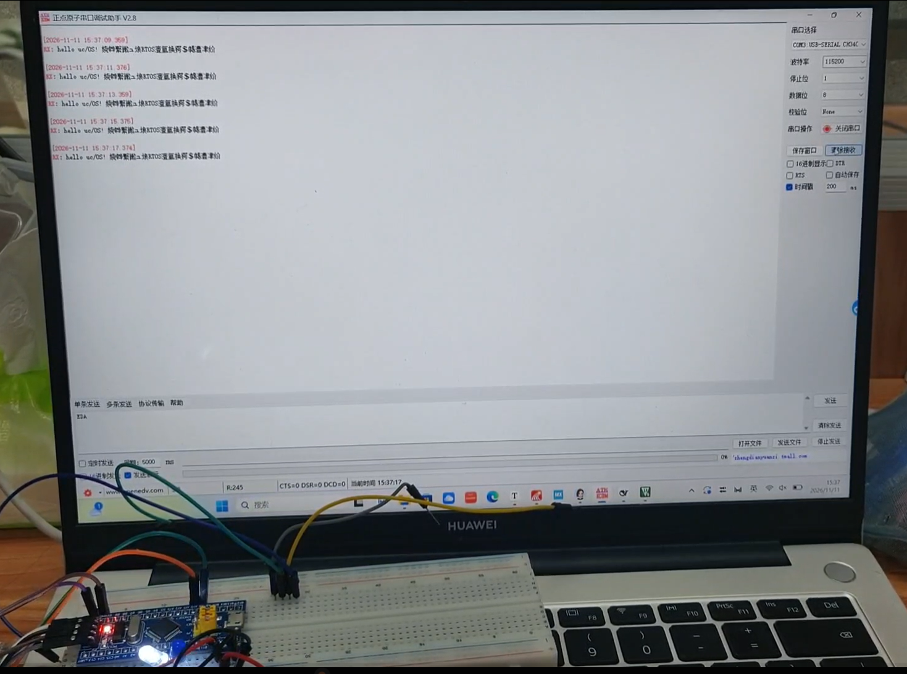

如视频所示， LED1，实现亮 1s、灭 1s，总周期 2s循环闪烁，LED2，实现亮 3s、灭 3s，总周期 6s循环闪烁。串口成功发送“hello uc/OS! 欢迎来到RTOS多任务环境！”语句。

## 3任务二：AHT20温湿度采集融合RTOS多任务

### 3.1搭建基础工程

🔷为后续提供工程配置与代码参考，AHT20接线如下：

| AHT20 | STM32F103C8T6 |
| ----- | ------------- |
| VCC   | 3.3 V         |
| GND   | GND           |
| SCL   | **PB6**       |
| SDA   | **PB7**       |

🔷时钟配置与任务一相同，我们需额外将PB6、PB7 配置为通用推挽开漏输出，开启上拉，高速模式

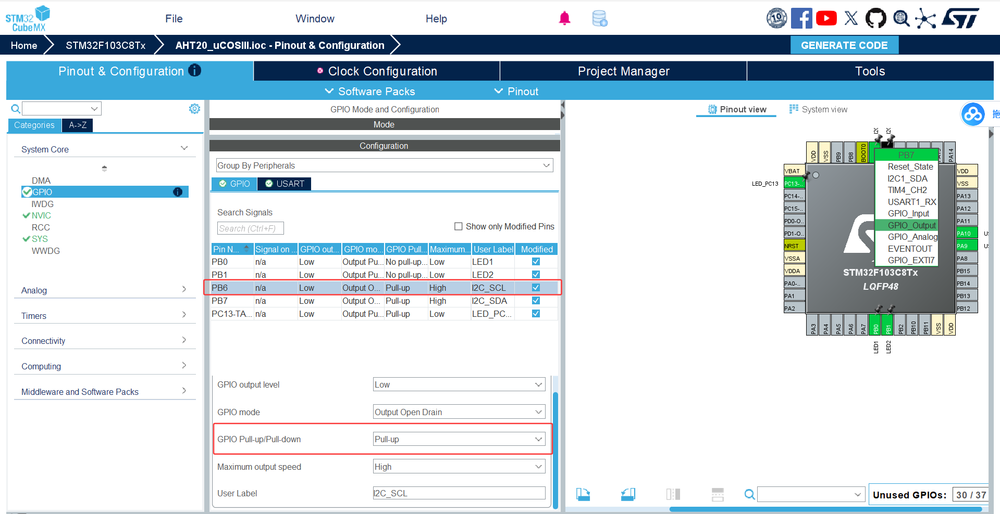

分别完成两个工程，裸机版本和RTOS 版本采集温湿度数据。 AHT20_Bare 是裸机工程，实现每 2 秒采集一次温湿度。AHT20_uCOSIII 在之前 uC/OS 任务一的基础上改造，把采集功能放到task3里面。

### 3.2 keil工程代码完善

#### 3.2.1软件 I2C 驱动实现

🔷GPIO 开漏与延时

这里直接操作 BSRR、BRR 寄存器，比 HAL_GPIO_WritePin 执行更快，I2C 波形也更干净。 延时没有用 HAL_Delay，它最小单位是 1ms，对 I2C 时序来说太慢。我写了简单的循环延时，72MHz、-O1 优化等级下，60 次循环大概 5~7 微秒，最终 SCL 频率大约 75kHz，满足 AHT20 最高 400kHz 的通信要求。

```c
#define SCL_H()    (GPIOB->BSRR = GPIO_PIN_6)
#define SCL_L()    (GPIOB->BRR  = GPIO_PIN_6)
#define SDA_H()    (GPIOB->BSRR = GPIO_PIN_7)
#define SDA_L()    (GPIOB->BRR  = GPIO_PIN_7)
#define SDA_READ() ((GPIOB->IDR & GPIO_PIN_7) ? 1u : 0u)

#define I2C_DELAY_LOOPS 60u
static void I2C_Delay(void)
{
    volatile uint32_t i = I2C_DELAY_LOOPS;
    while (i--) { __NOP(); }
}
```

🔷 起始、停止、读写字节

按照 I2C 协议写好 Start 和 Stop 函数，遵守电平变化时序。读取多字节的时候，最后一个字节发送 NACK，其余字节回复 ACK，适配 AHT20 读取 7 字节数据的要求。

```c
void I2C_Start(void)
{
    SDA_H(); SCL_H(); I2C_Delay();
    SDA_L(); I2C_Delay();
    SCL_L(); I2C_Delay();
}

void I2C_Stop(void)
{
    SDA_L(); I2C_Delay();
    SCL_H(); I2C_Delay();
    SDA_H(); I2C_Delay();
}

// 读一个字节，ack=1发ACK，ack=0发NACK
uint8_t I2C_ReadByte(uint8_t ack)
{
    uint8_t i, dat = 0;
    SDA_H();
    for(i = 0; i < 8; i++)
    {
        SCL_H(); I2C_Delay();
        dat <<= 1;
        if(SDA_READ()) dat |= 0x01;
        SCL_L(); I2C_Delay();
    }
    if(ack) SDA_L();
    else    SDA_H();
    I2C_Delay();
    SCL_H(); I2C_Delay();
    SCL_L(); I2C_Delay();
    return dat;
}
```

🔷AHT20 驱动

驱动函数先等待上电稳定，然后读取传感器状态。如果检测到未校准，就发送校准命令，延时 10ms；校准标志已经置位的话，直接跳过校准。另外单独写了测量触发函数，用来下发测量指令。

```c
uint8_t AHT20_Init(void)
{
    uint8_t status = 0;
    uint8_t cmd[3] = {0xBE, 0x08, 0x00};

    HAL_Delay(40);
    if (AHT20_ReadStatus(&status) != AHT20_OK) return AHT20_ERR_NACK;

    if ((status & 0x08) == 0)
    {
        if (AHT20_Write(cmd, 3) != AHT20_OK) return AHT20_ERR_NACK;
        HAL_Delay(10);
    }
    return AHT20_OK;
}

uint8_t AHT20_StartMeasurement(void)
{
    uint8_t cmd[3] = {0xAC, 0x33, 0x00};
    return AHT20_Write(cmd, 3);
}
```

### 3.3任务构建

#### 3.2.2 AHT20每2秒采集温湿度数据

裸机主循环里面，先触发一次测量，等待 80ms 转换完成，再读取温湿度数据。数据校验通过或者只是 CRC 出错，都会把温湿度通过串口打印出来。板载LED做心跳闪烁，同时用 HAL_GetTick 保证两次采集间隔严格 秒。 串口助手可以看到持续输出温湿度，编译没有报错和警告。

```C
while (1)
{
    uint32_t t_start = HAL_GetTick();
    if (AHT20_StartMeasurement() == AHT20_OK)
    {
        HAL_Delay(80);
        ret = AHT20_ReadResult(&temperature, &humidity);

        if (ret == AHT20_OK || ret == AHT20_ERR_CRC)
        {
            USART1_SendString("Temp: ");
            USART1_SendFloat2(temperature);
            USART1_SendString(" C, Humi: ");
            USART1_SendFloat2(humidity);
            USART1_SendString(" %RH\r\n");
        }
    }
    HAL_GPIO_TogglePin(GPIOC, GPIO_PIN_13);
    while ((HAL_GetTick() - t_start) < 2000u) { }
}
```

#### 3.2.3RTOS工程把Task3改成AHT20采集

原来任务 3 是每隔 2 秒打印字符串，现在替换成温湿度采集任务。 这里有个关键点：等待 80ms 测量转换的时候，不能用 HAL_Delay 忙等，要用 uC/OS 自带的 OSTimeDly。调用延时函数之后任务会主动让出 CPU，调度器可以切换去跑 LED 任务，不会卡住其他业务。 我把 2s 周期拆分，80ms 等待转换，剩下 1920ms 延时，保证整体周期刚好 2 秒。 实验现象：串口定时输出任务 3 采集的温湿度，同时两个 LED 任务依旧按照 1s、3s 的周期翻转，互不干扰。

```c
static void Task3_AHT20(void *p_arg)
{
    OS_ERR err;
    float temperature, humidity;
    uint8_t ret;

    while (1)
    {
        if (AHT20_StartMeasurement() == AHT20_OK)
        {
            OSTimeDlyHMSM(0, 0, 0, 80,
                          OS_OPT_TIME_DLY | OS_OPT_TIME_HMSM_STRICT, &err);
            ret = AHT20_ReadResult(&temperature, &humidity);

            if (ret == AHT20_OK || ret == AHT20_ERR_CRC)
            {
                USART1_SendString("[Task3] Temp: ");
                USART1_SendFloat2(temperature);
                USART1_SendString(" C, Humi: ");
                USART1_SendFloat2(humidity);
                USART1_SendString(" %RH\r\n");
            }
        }
        OSTimeDlyHMSM(0, 0, 1, 920,
                      OS_OPT_TIME_PERIODIC | OS_OPT_TIME_HMSM_STRICT, &err);
    }
}
```

#### 3.4实验现象

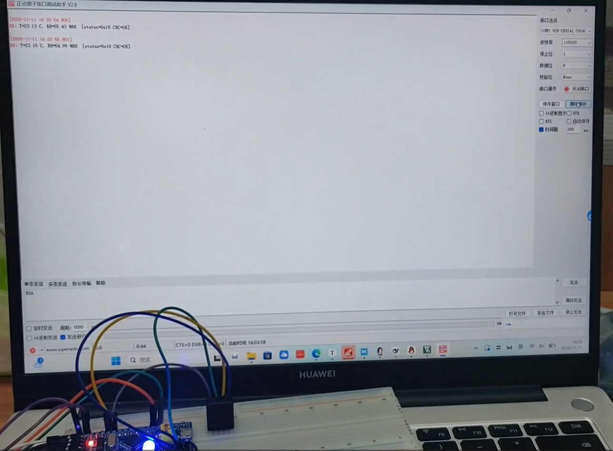

在任务一工程基础上修改task3，不再输出固定字符串，改为每2s调用软件I2C读取AHT20温湿度，将温度、湿度数值打印至串口助手。LED1、LED2依旧保持原有 1s、3s 的闪烁节奏。

#### 3.5波形分析

使用 Keil 软件仿真的虚拟逻辑分析仪，添加 PB6、PB7 引脚观测逻辑波形。

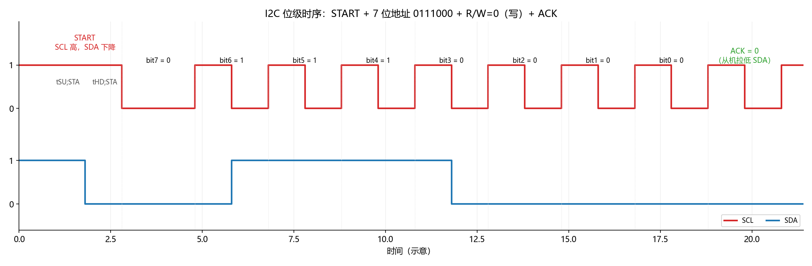

I2C 总线基础位时序，红色波形为SCL时钟线，蓝色波形为SDA数据线。 SCL 保持高电平期间，SDA 由高电平跳变到低电平，标志一次 I2C 通信开始。 随后主机依次送出 7 位地址0111000，最低位 R/W=0 代表写操作。数据传输遵循 I2C 规范：SDA 仅能在 SCL 为低电平时改变电平，SCL 拉高时 SDA 电平稳定，供从机采样。 8bit 发送完成后，第 9 个时钟周期为应答位 ACK，由从机主动把 SDA 拉低，表示成功接收地址。 图中建立时间，是 I2C 协议规定的时序参数。

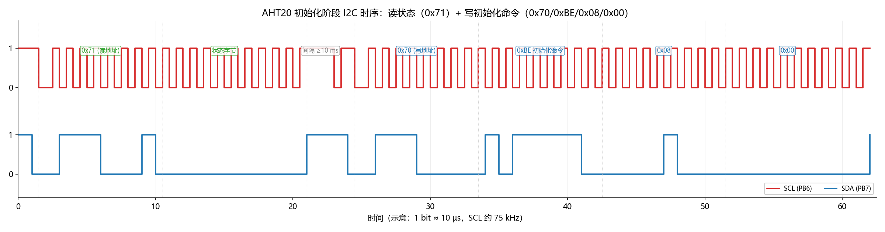

该波形为 AHT20 传感器上电初始化阶段的完整 I2C 交互流程。 主机首先发送读地址0x71，读取传感器状态字节，判断传感器是否已经完成校准； 若未校准，总线保持空闲延时≥10ms；之后主机发送写地址0x70，依次下发校准命令0xE1，附带参数0x08、0x00。 每发送一个字节，从机都会回复 ACK 应答。这段时序对应实验中 AHT20 的初始化校准流程，让传感器进入正常工作模式。

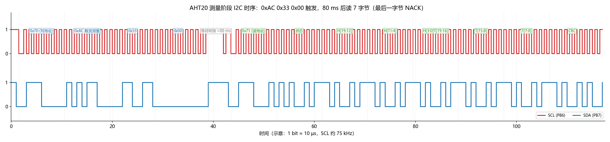

该波形为 AHT20 温湿度测量的通信时序。 主机先发写地址0x70，下发测量触发命令0xAC以及参数0x33、0x00，启动 AD 转换； 随后总线保持约 80ms 空闲，这段时间 AHT20 内部完成温湿度信号转换，不响应主机信号。 等待结束后，主机发送读地址0x71，连续读取 7 字节数据：状态字节、湿度高 2 字节、温度高 2 字节、CRC 校验字节。 读完全部 7 字节后，主机输出 NACK，随后发送停止信号结束本次采集，这是AHT20读取流程。

## 9 总结

本次实验完成了uC/OS在STM32F103的移植，实现多任务调度，并结合软件I2C驱动AHT20温湿度传感器，完成数据采集与串口输出，同时借助Keil虚拟逻辑分析仪对I2C总线时序进行观察分析。通过完整的移植、编码、调试与波形观测，我对嵌入式实时操作系统与I2C通信协议有了更加具象的理解。

在移植uC/OS‑III的中，我认识到 RTOS 移植的核心并不是修改内核源码，而是做好处理器Port层的适配工作。前期调试时曾出现 LED 只亮不灭、任务无法切换的现象，排查后意识到是系统节拍相关配置不匹配，导致延时函数失效，任务调度无法正常运行。这让我体会到，使用 RTOS 开发不能只关注业务逻辑，内核底层的每一项配置都会影响任务是否可以正常调度。

多任务部分共建立三个任务，分别实现两路 LED 周期性闪烁与 AHT20 温湿度采集。不同于裸机顺序执行，uC/OS是抢占式内核，OSTimeDlyHMSM为任务阻塞延时，任务挂起时CPU可调度其他任务，实现宏观并发。 实验体会到 RTOS 延时与裸机HAL_Delay忙等待的区别：AHT20 触发测量后需要80ms转换时间，若使用忙等待会占用 CPU，阻塞 LED 任务；使用RTOS延时，任务主动让出CPU，保证各任务独立运行。同时理解了OS_OPT_TIME_PERIODIC的作用，它以上次唤醒时刻为计时基准，能够减小任务执行带来的周期时间漂移。

I2C部分对比了硬件与软件I2C的优缺点。由于STM32F1硬件I2C存在死锁bug，本实验采用软件I2C，直接操作 GPIO模拟SCL、SDA时序，实现起始、停止、读写、应答等底层协议函数。实验中注意到从机地址的转换问题：AHT20的7位地址为 0x38，总线写地址为0x70、读地址为 0x71，地址处理错误将无法获取传感器应答。借助Keil 虚拟逻辑分析仪观察波形，尽管仿真时序和真实硬件存在偏差，但可以直观看到起始信号、ACK应答、校准命令以及测量阶段80ms总线空闲，结合波形对照手册，加深了对 I2C 时序协议的理解。

调试过程暴露出自身的不足：很多故障并非业务代码错误，而是对底层原理掌握不扎实，容易忽视内核配置、中断时机、任务栈、时序参数等细节。程序运行异常时需要分层排查，依次检查硬件接线、底层驱动、RTOS 配置，逐步定位问题。

通过本次实验，我熟悉了uC/OS移植流程，理解多任务编程思想与I2C通信原理。RTOS将不同功能拆分为独立任务，由内核统一调度，便于后续功能扩展。同时也认识到RTOS开发不仅要写业务逻辑，栈管理、中断与内核的配合同样重要。后续我会加强相关知识学习，遇到问题优先分析原理，养成规范的调试排错习惯。
