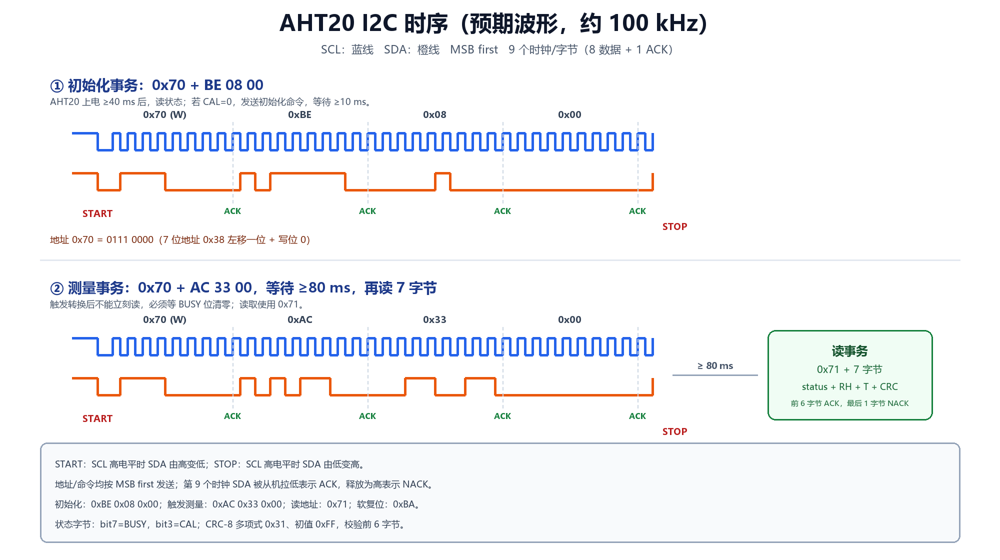

# AHT20 与 I2C 协议详解



本文对应工程 `AHT20_uCOSII_STM32F103`，软件 I2C 使用 PB6（SCL）、PB7（SDA）。

---

## 1. I2C 物理层要点

I2C 是两线、开漏、多主多从的总线：

| 信号 | 作用 |
|---|---|
| SCL | 时钟，由主机产生 |
| SDA | 数据，双向，开漏 |
| 上拉电阻 | SCL/SDA 各接一个 4.7 kΩ 到 3.3 V，空闲时都为高 |

因为 GPIO 配置为**开漏输出**：

- 写 0：引脚主动拉低；
- 写 1：引脚释放，由上拉电阻拉高；
- 从机可以在 ACK 时钟把 SDA 拉低，主机通过读 IDR 采样。

AHT20 模块通常板载 4.7 kΩ 上拉；如果没有，必须外接。没有上拉时，总线无法回到高电平，
表现就是一直 NACK 或读不到数据。

---

## 2. 起始、停止、应答

### 2.1 START

SCL 为高时，SDA 由高变低：

```text
SCL ────────┐
            │
SDA ──┐     │
      └─────┘
        START
```

### 2.2 STOP

SCL 为高时，SDA 由低变高：

```text
SCL ────────┐
            │
SDA ────────┘
        STOP
```

### 2.3 数据位与 ACK

- 每个字节 8 位，**MSB first**（最高位先发）。
- 第 9 个时钟是应答位：
  - 从机拉低 SDA = **ACK**；
  - SDA 保持高 = **NACK**。
- 主机读数据时，读完后由主机决定第 9 个时钟是 ACK 还是 NACK：
  - 还要继续读：主机给 ACK（SDA 低）；
  - 最后一个字节：主机给 NACK（SDA 释放高），然后 STOP。

本工程软件 I2C 的 `I2C_WriteByte()`、`I2C_ReadByte()` 就是按这个顺序实现的。

---

## 3. AHT20 的 I2C 地址

AHT20 的 **7 位地址是 `0x38`**。

I2C 总线上传输的是 8 位“地址 + 读写位”：

```text
7 位地址 0x38 = 011 1000
写：0111 0000 = 0x70   （0x38 << 1 | 0）
读：0111 0001 = 0x71   （0x38 << 1 | 1）
```

所以程序里：

```c
#define AHT20_I2C_ADDR_7BIT   0x38u
#define AHT20_I2C_ADDR_WRITE  0x70u
#define AHT20_I2C_ADDR_READ   0x71u
```

初始化、写命令用 `0x70`，读状态/读测量结果用 `0x71`。

---

## 4. 初始化阶段

AHT20 上电后不能立刻测量，流程如下：

```text
上电
  │
  ├─ 等待 ≥ 40 ms
  │
  ├─ 读状态（0x71，读 1 字节）
  │
  ├─ 如果 status.bit3（CAL）= 0：
  │    写 0x70 + BE 08 00
  │    等待 ≥ 10 ms
  │    再读状态
  │
  └─ CAL=1 后，才可以触发测量
```

### 4.1 程序发送的初始化命令

```text
从机地址：0x70（写）
命令字节：0xBE 0x08 0x00
```

对应代码：

```c
if ((status & AHT20_STATUS_CALIBRATED) == 0u)
{
    AHT20_WriteCommand(0xBE, 0x08, 0x00);
    HAL_Delay(10u);
    AHT20_ReadStatus(&status);
}
```

`0xBE` 是初始化/校准命令，`0x08` 和 `0x00` 是命令参数。
初始化完成后，状态字节的 **bit3（0x08）** 应该为 1，表示已校准。

> 有些模块出厂已经校准，读到的 status.bit3 本来就是 1，此时程序不会重复发送 0xBE；
> 这是正常的。想强制重新初始化，可以先发软复位 `0xBA`，再走初始化流程。

### 4.2 软复位

AHT20 支持软复位命令：

```text
0x70 + 0xBA
```

本工程提供 `AHT20_SoftReset()`，但主流程不调用它；一般只在传感器状态异常时使用。

---

## 5. 测量阶段

### 5.1 触发测量

```text
0x70 + AC 33 00
```

| 字节 | 含义 |
|---|---|
| `0xAC` | 触发测量命令 |
| `0x33` | 命令参数 1 |
| `0x00` | 命令参数 2 |

### 5.2 等待

AHT20 转换需要时间，数据手册要求 **≥ 80 ms**。程序使用：

```c
(void)OSTimeDlyHMSM(0u, 0u, 0u, 80u);
```

这里故意不用 `HAL_Delay()`：`OSTimeDlyHMSM()` 会让出 CPU，LED 任务可以继续运行。
如果用 `HAL_Delay(80)`，CPU 会空转 80 ms，低优先级任务被无谓阻塞。

### 5.3 读 7 字节

```text
0x71 + 读 7 字节
```

7 字节布局：

| 字节 | 内容 |
|---|---|
| `data[0]` | 状态：bit7=BUSY，bit3=CAL |
| `data[1]` | 湿度 [19:12] |
| `data[2]` | 湿度 [11:4] |
| `data[3]` | 湿度 [3:0]（高 4 位） + 温度 [19:16]（低 4 位） |
| `data[4]` | 温度 [15:8] |
| `data[5]` | 温度 [7:0] |
| `data[6]` | CRC-8 |

读取时前 6 个字节主机回 ACK，最后 1 个字节回 NACK，然后 STOP。

---

## 6. 数据转换

AHT20 的湿度和温度都是 20 位无符号数：

```c
raw_h = ((uint32_t)data[1] << 12) |
        ((uint32_t)data[2] << 4)  |
        ((uint32_t)data[3] >> 4);

raw_t = (((uint32_t)data[3] & 0x0F) << 16) |
        ((uint32_t)data[4] << 8) |
        ((uint32_t)data[5]);
```

转换公式：

```text
RH  = raw_h / 2^20 * 100      (%RH)
T   = raw_t / 2^20 * 200 - 50 (℃)
```

`2^20 = 1048576`。代码：

```c
data->humidity    = ((float)raw_h * 100.0f) / 1048576.0f;
data->temperature = ((float)raw_t * 200.0f) / 1048576.0f - 50.0f;
```

例如：

```text
raw_h = 0x8F5C2  ->  RH  ≈ 56.0 %RH
raw_t = 0x65A3C  ->  T   ≈ 26.0 ℃
```

具体数值随环境变化。

---

## 7. CRC-8 校验

AHT20 的 CRC 参数：

```text
多项式：0x31
初值：  0xFF
范围：  data[0] ~ data[5]（前 6 字节）
结果：  与 data[6] 比较
```

代码：

```c
uint8_t AHT20_CRC8(const uint8_t *data, uint8_t len)
{
    uint8_t crc = 0xFFu;
    for (i = 0; i < len; i++)
    {
        crc ^= data[i];
        for (bit = 0; bit < 8; bit++)
        {
            crc = (crc & 0x80u) ? ((crc << 1) ^ 0x31u) : (crc << 1);
        }
    }
    return crc;
}
```

任务把结果显示为 `CRC=OK` 或 `CRC=ERR`。

> CRC 错误不一定是数据完全不能用，但说明总线可能受干扰或读取时序有问题。
> 如果持续 `CRC=ERR`，优先检查上拉电阻、杜邦线长度、SCL 频率和共地。

---

## 8. 软件 I2C 代码结构

### 8.1 `i2c_soft.c`

| 函数 | 作用 |
|---|---|
| `I2C_Init()` | PB6/PB7 配置为开漏输出，使能 DWT 延时 |
| `I2C_DelayUs()` | DWT 周期计数延时，约 5 µs 半周期 |
| `I2C_Start()` | START 条件 |
| `I2C_Stop()` | STOP 条件 |
| `I2C_WriteByte()` | 发 8 位，读第 9 位 ACK |
| `I2C_ReadByte()` | 读 8 位，发 ACK/NACK |
| `I2C_Write()` | 地址 + 多个字节 + STOP |
| `I2C_Read()` | 地址 + 读多个字节 + STOP |

`g_i2c_scl`、`g_i2c_sda` 在每次引脚变化时更新，专门给 Keil 逻辑分析仪观察。

### 8.2 `aht20.c`

| 函数 | 作用 |
|---|---|
| `AHT20_Init()` | 40 ms 上电等待、读状态、按需发 `BE 08 00` |
| `AHT20_ReadStatus()` | 从 0x71 读 1 字节状态 |
| `AHT20_StartMeasurement()` | 发 `AC 33 00` |
| `AHT20_ReadMeasurement()` | 读 7 字节、检查 BUSY、换算、CRC |
| `AHT20_SoftReset()` | 发 `BA` 软复位 |
| `AHT20_CRC8()` | CRC-8/0x31/0xFF |

### 8.3 为什么用软件 I2C

- 可以直接观察 PB6/PB7 的每一位，便于逻辑分析仪实验；
- 不依赖 STM32 的 I2C 外设，不会被硬件状态机/中断时序干扰；
- 代码短，适合理解协议。

如果以后要用硬件 I2C，可以把 PB6/PB7 改为 `I2C1_SCL/I2C1_SDA` 复用功能，
用 `HAL_I2C_Master_Transmit()`/`HAL_I2C_Master_Receive()` 替代 `I2C_Write()`/`I2C_Read()`，
AHT20 的地址和命令不变。

---

## 9. 一次完整事务的字节序列

### 初始化

```text
START
0x70  ACK
0xBE  ACK
0x08  ACK
0x00  ACK
STOP
```

### 触发测量

```text
START
0x70  ACK
0xAC  ACK
0x33  ACK
0x00  ACK
STOP
```

### 读取

```text
START
0x71  ACK
data[0] ACK
data[1] ACK
data[2] ACK
data[3] ACK
data[4] ACK
data[5] ACK
data[6] NACK
STOP
```

---

## 10. 参考

- AHT20 数据手册中的 I2C 地址、初始化命令、测量命令和转换公式。
- NetBSD `aht20reg.h` 命令定义：  
  <http://ftp.iij.ad.jp/pub/NetBSD/NetBSD-current/src/sys/dev/i2c/aht20reg.h>
- 立创开发板 AHT20 模块说明（软件 I2C 移植示例）：  
  <https://openkits-wiki.easyeda.com/zh-hans/lspi/module/sensor/aht20-temperature-and-humidity-sensor.html>
