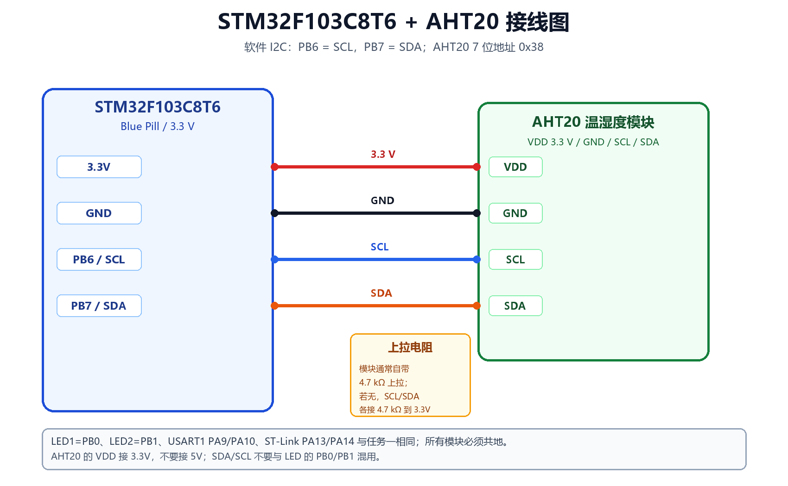

# 实物接线教程（AHT20 版本）



本工程在任务一的基础上增加 AHT20。LED、USART1、ST-Link 的接法不变，新增 AHT20 的
四根线：VDD、GND、SCL、SDA。

---

## 1. 准备材料

| 材料 | 数量 | 说明 |
|---|---:|---|
| STM32F103C8T6 最小系统板 | 1 | Blue Pill，8 MHz 晶振 |
| AHT20 温湿度模块 | 1 | 3.3 V，I2C 接口 |
| LED | 2 | 红/绿/黄/蓝均可 |
| 电阻 | 2 | 220 Ω～330 Ω（LED 限流） |
| 电阻 | 2（可选） | 4.7 kΩ，模块无上拉时接 SCL/SDA 到 3.3 V |
| 面包板/杜邦线 | 若干 | 公对公/公对母按接口选择 |
| USB-TTL 串口模块 | 1 | CH340/CP2102/FT232，3.3 V 逻辑 |
| ST-Link V2 | 1 | SWD 下载/调试 |

---

## 2. 引脚分配

| STM32F103 | 连接到 | 说明 |
|---|---|---|
| 3.3V | AHT20 VDD/VCC | **3.3 V**，不要接 5 V |
| GND | AHT20 GND | 公共地 |
| PB6 | AHT20 SCL | 软件 I2C 时钟 |
| PB7 | AHT20 SDA | 软件 I2C 数据 |
| PB0 | 220 Ω → LED1 正极 | LED1，高电平点亮 |
| PB1 | 220 Ω → LED2 正极 | LED2，高电平点亮 |
| PA9 | USB-TTL RXD | USART1_TX |
| PA10 | USB-TTL TXD | USART1_RX |
| PA13 | ST-Link SWDIO | 下载/调试 |
| PA14 | ST-Link SWCLK | 下载/调试 |

---

## 3. AHT20 接线

AHT20 模块通常有 4 个引脚，丝印可能是：

```text
VDD  GND  SCL  SDA
```

也可能标成：

```text
VCC  GND  SCL  SDA
```

### 3.1 接线步骤

1. 开发板 **3.3V** → AHT20 **VDD/VCC**；
2. 开发板 **GND** → AHT20 **GND**；
3. 开发板 **PB6** → AHT20 **SCL**；
4. 开发板 **PB7** → AHT20 **SDA**。

```text
STM32F103                 AHT20
3.3V  ──────────────────  VDD
GND   ──────────────────  GND
PB6   ──────────────────  SCL
PB7   ──────────────────  SDA
```

### 3.2 上拉电阻

I2C 的 SCL/SDA 是开漏总线，必须有上拉电阻。

- 大多数 AHT20 模块板载 **4.7 kΩ** 上拉，直接接线即可；
- 如果模块没有上拉，在 **SCL 与 3.3V**、**SDA 与 3.3V** 之间各接一个 **4.7 kΩ**；
- 不要接 10 kΩ 以上的大阻值再加长杜邦线，上升沿会变慢，100 kHz 也可能读错。

### 3.3 电源

AHT20 工作电压 2.0～5.5 V，但本工程逻辑电平是 3.3 V，建议统一用 **3.3 V**。
不要给 AHT20 的 VDD 接 5 V 后再直接连 PB6/PB7（虽然 PB6/PB7 有些引脚是 5 V 容忍，
但没有必要冒险）。

---

## 4. LED 接线

与任务一相同：

```text
PB0 ──[ 220 Ω ]── LED1 长脚（+）── LED1 短脚（-）── GND
PB1 ──[ 220 Ω ]── LED2 长脚（+）── LED2 短脚（-）── GND
```

- LED 长脚 = 正极，短脚 = 负极；
- 高电平点亮；
- 必须串联限流电阻。

---

## 5. 串口接线

| STM32F103 | USB-TTL |
|---|---|
| PA9（TX） | **RXD** |
| PA10（RX） | **TXD** |
| GND | GND |

串口参数：`115200 8N1`，终端编码 `UTF-8`。

---

## 6. ST-Link 接线

| ST-Link | STM32F103 |
|---|---|
| SWDIO | PA13 |
| SWCLK | PA14 |
| GND | GND |
| 3.3V | 3.3V（可选供电） |

---

## 7. 供电方式（三选一）

1. **ST-Link 3.3V 供电**：ST-Link 的 3.3V 接开发板 3.3V，GND 共地；
2. **USB-TTL 3V3 供电**：USB-TTL 的 3V3 接开发板 3.3V，GND 共地；
3. **开发板 USB 供电**：开发板直接插 USB，USB-TTL/ST-Link 只接信号和 GND。

注意：

- 只能选一种 3.3V 电源，不要把两个 3.3V 输出接在一起；
- 所有模块的 GND 必须相连；
- 不要把 USB-TTL 的 5V 接到开发板 3.3V；
- 不要带电插拔 AHT20 的 VDD/GND，先断电再改线。

---

## 8. 上电前检查

1. 万用表蜂鸣档测 3.3V 与 GND，确认没有短路；
2. 确认 AHT20 的 VDD 接 3.3V，不是 5V；
3. 确认 PB6→SCL、PB7→SDA，没有接反；
4. 确认 SCL/SDA 有上拉（模块板载或外接 4.7 kΩ）；
5. 确认 LED 串联了电阻，极性正确；
6. 确认只有一个 3.3V 电源；
7. 确认 BOOT0=0（从 Flash 启动）。

---

## 9. 上电后的现象

1. LED1（PB0）每 0.5 s 翻转，完整周期 1 s；
2. LED2（PB1）每 1.5 s 翻转，完整周期 3 s；
3. 串口先打印启动信息，然后每 2 s 打印一行温湿度；
4. 用手捂住 AHT20 或对它哈气，湿度会上升，温度可能略微上升；
5. 串口每行末尾 `CRC=OK` 表示数据校验通过。

如果串口显示 `AHT20 init: FAIL`，先检查 AHT20 的 3.3V/GND、PB6/PB7 和上拉电阻。
