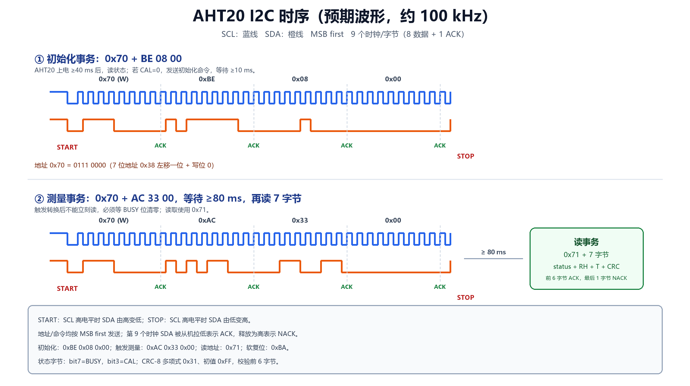

# Keil 虚拟逻辑分析仪观察 I2C 时序



本文说明如何在 **Keil MDK 的 Simulator** 中用 Logic Analyzer 观察 PB6（SCL）/PB7（SDA）
的软件 I2C 波形，并对照 AHT20 数据手册分析地址、命令和 ACK。

> 重要：Keil 仿真器里没有 AHT20 从机模型。默认代码在地址字节收不到 ACK 时会停止，
> 所以只能看到 START + 0x70 + NACK。为了在仿真中看到完整的 `BE 08 00`、`AC 33 00`
> 和 7 字节读时序，工程提供了一个**仅用于仿真**的开关 `I2C_SIMULATE_ACK`。

---

## 1. 打开仿真模式

### 1.1 选择 Use Simulator

Keil 菜单：

```text
Project -> Options for Target -> Debug
```

左侧选择 **Use Simulator**（不要选 ST-Link），点击 OK。

### 1.2 打开 I2C 仿真 ACK

打开 `Core/Inc/i2c_soft.h`，把：

```c
#define I2C_SIMULATE_ACK    0
```

临时改成：

```c
#define I2C_SIMULATE_ACK    1
```

重新编译（F7）。

此时：

- `I2C_WriteByte()` 会假装每个字节都收到 ACK；
- `main()` 会调用 `AHT20_LogicAnalyzerDemo()`，依次产生：
  - 初始化命令 `0x70 + BE 08 00`；
  - 测量命令 `0x70 + AC 33 00`；
  - 读事务 `0x71 + 7 字节`。
- 因为仿真器没有真实从机，读回的 7 字节通常是 `0xFF`，这是正常的，只用于看波形。

> **实验结束后必须把 `I2C_SIMULATE_ACK` 改回 0**，再重新编译下载到实物。
> 否则程序会以为不存在的从机也 ACK，实物通信会出错。

---

## 2. 添加 Logic Analyzer 信号

1. 进入调试：`Debug -> Start/Stop Debug Session`（Ctrl+F5）。
2. 打开：

```text
View -> Analysis Windows -> Logic Analyzer
```

3. 点击 `Setup...`，在 Logic Analyzer 对话框中点击 `New`（或 `Setup`）。
4. 输入信号名：

```text
g_i2c_scl
```

5. `Display Type` 选择 **Bit**，颜色选蓝色。
6. 再 `New` 一个：

```text
g_i2c_sda
```

7. `Display Type` 选择 **Bit**，颜色选橙色。
8. 点击 `Close`。

如果提示找不到符号：

- 确认已经 Rebuild，且 `g_i2c_scl`/`g_i2c_sda` 没有被优化掉（它们是 `volatile` 全局变量）；
- 把优化等级临时改为 `-O0`；
- 确认是在 `Debug` 会话中，而不是直接运行。

---

## 3. 捕获一次完整事务

### 3.1 方法 A：在 demo 函数处停下

1. 在 `Core/Src/main.c` 中找到：

```c
AHT20_LogicAnalyzerDemo();
```

2. 在这一行设置断点（F9）。
3. 按 F5 运行，程序会停在这里。
4. 按 F10（Step Over）执行完这个函数。
5. Logic Analyzer 窗口应该已经记录了完整的初始化、测量和读时序。
6. 用 `Zoom In`、`Zoom Out`、`Auto` 或鼠标滚轮查看细节。

### 3.2 方法 B：在 I2C_Stop 处设断点

如果方法 A 的波形太长，可以在 `i2c_soft.c` 的 `I2C_Stop()` 内设断点，
每次 STOP 后查看一段事务；再继续运行看下一段。

---

## 4. 波形怎么读

### 4.1 初始化事务

预期字节序列：

```text
START
0x70  ACK
0xBE  ACK
0x08  ACK
0x00  ACK
STOP
```

在 Logic Analyzer 中：

- SCL 是一串时钟；
- SDA 在 SCL 高电平期间变化的数据位就是命令；
- 每 9 个 SCL 脉冲对应 1 个字节（8 数据 + 1 ACK）；
- 第 9 个脉冲期间 SDA 被拉低 = ACK（仿真模式下强制为 ACK）。

### 4.2 测量事务

```text
START
0x70  ACK
0xAC  ACK
0x33  ACK
0x00  ACK
STOP
```

等待 80 ms 后：

```text
START
0x71  ACK
data[0] ACK
data[1] ACK
data[2] ACK
data[3] ACK
data[4] ACK
data[5] ACK
data[6] NACK
STOP
```

### 4.3 起始/停止条件

| 条件 | SCL | SDA |
|---|---|---|
| START | 高 | 由高变低 |
| STOP | 高 | 由低变高 |
| 数据有效 | 高 | 保持稳定 |
| 数据变化 | 低 | 允许变化 |

在波形上找 START：SCL 高电平期间 SDA 出现下降沿。
找 STOP：SCL 高电平期间 SDA 出现上升沿。

---

## 5. 时间参数估算

本工程软件 I2C 的半周期是 5 µs：

```text
SCL 低电平约 5 µs
SCL 高电平约 5 µs
一个时钟周期约 10 µs
SCL 频率约 100 kHz
```

实际值会因 GPIO 操作和中断略大，但仍在 100 kHz 附近。AHT20 支持 100 kHz 和 400 kHz，
100 kHz 更稳妥。

一个字节 9 个时钟 ≈ 90 µs；初始化 4 个字节 ≈ 360 µs；测量触发 4 个字节 ≈ 360 µs；
读 8 个字节（地址 + 7 数据）≈ 720 µs。加上 80 ms 转换等待，一次完整采集约 81 ms。

> Keil 仿真器是指令级模拟，Logic Analyzer 记录的是变量变化，不是真实电压。
> 真实板子上仍建议用示波器/逻辑分析仪测 PB6/PB7，确认上升沿和电平。

---

## 6. 对照 AHT20 数据手册

### 6.1 地址

| 项目 | 值 |
|---|---|
| 7 位地址 | `0x38` |
| 写地址 | `0x70` |
| 读地址 | `0x71` |

波形中第一个字节应该是 `0x70`（写），读数据时是 `0x71`。

### 6.2 初始化阶段发送的命令

```text
0xBE 0x08 0x00
```

- `0xBE`：初始化/校准命令；
- `0x08`、`0x00`：命令参数；
- 发送后等待 ≥10 ms；
- 状态字节 bit3（0x08）为 1 表示校准完成。

### 6.3 测量阶段发送的命令

```text
0xAC 0x33 0x00
```

- `0xAC`：触发测量；
- `0x33`、`0x00`：参数；
- 等待 ≥80 ms；
- 然后从 `0x71` 读 7 字节。

### 6.4 读 7 字节

```text
status, RH[19:12], RH[11:4], RH[3:0]+T[19:16], T[15:8], T[7:0], CRC
```

转换：

```text
RH = raw_h / 2^20 * 100 %RH
T  = raw_t / 2^20 * 200 - 50 ℃
```

---

## 7. 仿真模式与实物模式对比

| 项目 | 仿真模式 | 实物模式 |
|---|---|---|
| `I2C_SIMULATE_ACK` | 1 | **0** |
| AHT20 从机 | 无，强制 ACK | 真实 AHT20 |
| 读回数据 | 通常 0xFF | 真实温湿度 |
| CRC | 不可信 | 可检查 |
| 用途 | 看波形、分析协议 | 实际采集 |
| 下载前 | 必须改回 0 | 保持 0 |

---

## 8. 常见问题

### 8.1 Logic Analyzer 没有信号

- 没有进入 Debug 会话；
- 信号名拼错（区分大小写）；
- 变量被优化掉，临时改 `-O0`；
- 代码没有运行到 I2C 函数。

### 8.2 只有 START 和 0x70，没有后续命令

- `I2C_SIMULATE_ACK` 还是 0，仿真器没有从机 ACK，代码在地址字节后停止；
- 按本文第 1 节临时改为 1，重新编译。

### 8.3 波形太密看不清

- 用 `Zoom In` 放大；
- 只保留 `g_i2c_scl` 或 `g_i2c_sda` 其中一个；
- 在 `I2C_Stop()` 设断点，分段看。

### 8.4 实物读不到数据

仿真波形正常不代表实物接线正确。检查：

- AHT20 的 3.3V/GND；
- PB6→SCL、PB7→SDA；
- 上拉电阻；
- `I2C_SIMULATE_ACK` 是否已经改回 0；
- 串口是否 115200 8N1。
