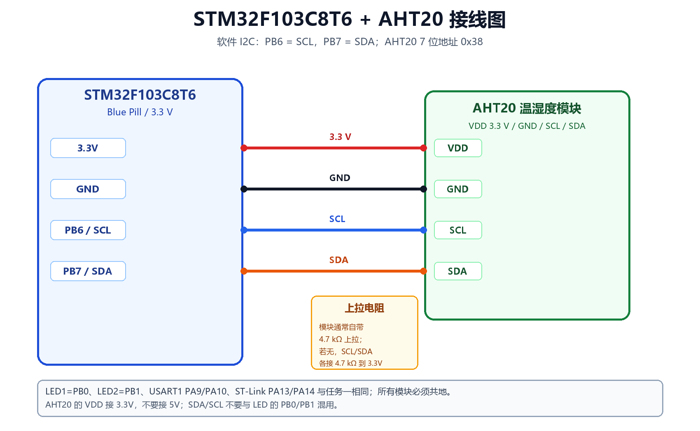

# STM32F103 + uC/OS-II + AHT20 温湿度采集实验

> 任务二：在任务一的多任务工程基础上，把第 3 个任务改为每 2 秒采集一次 AHT20 温湿度，
> 并通过 USART1 发送到上位机；第 1、2 个任务仍然控制 PB0/PB1 两个 LED。

## 1. 工程位置

- 工程根目录：`D:\Keil5\STM32hal\AHT20_uCOSII_STM32F103`
- Keil 工程：`MDK-ARM\AHT20_uCOSII_STM32F103.uvprojx`
- CubeMX 配置：`AHT20_uCOSII_STM32F103.ioc`
- 芯片：STM32F103C8T6，8 MHz 晶振，72 MHz 主频
- 内核：uC/OS-II V2.92.11
- 传感器：AHT20，I2C 7 位地址 **0x38**
- I2C：**软件 I2C**，PB6 = SCL，PB7 = SDA，约 100 kHz
- 串口：USART1，PA9=TX，PA10=RX，115200 8N1
- 编译器验证：ARMCC V5.06 update 5，**0 Error(s), 0 Warning(s)**

> 任务一工程仍在 `D:\Keil5\uCOSII_STM32F103`，本工程是它的 AHT20 版本，二者互不覆盖。
> uC/OS-II 的 PendSV/SysTick 移植细节见
> [任务一移植文档](D:/Keil5/STM32hal/uCOSII_STM32F103/Doc/01_移植过程详解.md)。

## 2. 三个任务

| 任务 | 优先级 | 功能 | 周期 |
|---|---:|---|---|
| Task1_LED1 | 4 | PB0 高电平点亮，亮 0.5 s、灭 0.5 s | 1 s |
| Task2_LED2 | 5 | PB1 高电平点亮，亮 1.5 s、灭 1.5 s | 3 s |
| Task3_AHT20 | 6 | 触发 AHT20 转换，读 7 字节，串口打印温度/湿度 | 2 s |

Task3 的流程：

```text
触发测量：0x70 + AC 33 00
等待：80 ms（OSTimeDlyHMSM，让出 CPU）
读取：0x71 + 7 字节
转换：20 位湿度、20 位温度
打印：T=xx.xx C, RH=xx.xx %RH [status=0x18 CRC=OK]
```

串口输出示例：

```text
===== uC/OS-II V2.92 + AHT20 on STM32F103C8T6 =====
Clock: 72 MHz, Tick: 1 ms, UART: 115200 8N1
LED1=PB0 (1 s), LED2=PB1 (3 s), AHT20 task=2 s
AHT20: SCL=PB6, SDA=PB7, 7-bit addr=0x38
AHT20 init: OK (addr 0x38, init cmd BE 08 00)

T=26.45 C, RH=58.32 %RH  [status=0x18 CRC=OK]
T=26.47 C, RH=58.30 %RH  [status=0x18 CRC=OK]
...
```

如果传感器未接好，会看到：

```text
AHT20 init: FAIL (check wiring/pull-ups)
AHT20 init failed: check PB6/PB7 and 0x38
```

## 3. 接线



| STM32F103 | AHT20 模块 | 说明 |
|---|---|---|
| 3.3V | VDD / VCC | 3.3 V 供电 |
| GND | GND | 公共地 |
| PB6 | SCL | I2C 时钟 |
| PB7 | SDA | I2C 数据 |

AHT20 模块通常自带 4.7 kΩ 上拉电阻；如果模块没有上拉，需要在 SCL、SDA 与 3.3V 之间各接一个 4.7 kΩ 电阻。
详细接线见 [Doc/04_接线教程.md](Doc/04_接线教程.md)。

## 4. AHT20 的关键协议参数

| 项目 | 值 |
|---|---|
| 7 位地址 | `0x38` |
| 写地址（8 位形式） | `0x70` |
| 读地址（8 位形式） | `0x71` |
| 初始化命令 | `0xBE 0x08 0x00` |
| 触发测量命令 | `0xAC 0x33 0x00` |
| 读取长度 | 7 字节（状态 + 5 字节数据 + CRC） |
| 转换时间 | ≥ 80 ms |
| 软复位 | `0xBA` |
| 状态位 | bit7=BUSY，bit3=CAL（已校准） |
| CRC | CRC-8，多项式 `0x31`，初值 `0xFF`，校验前 6 字节 |

转换公式：

```text
RH  = raw_h / 2^20 * 100      (%RH)
T   = raw_t / 2^20 * 200 - 50 (℃)
```

详细协议、时序和代码解析见 [Doc/01_AHT20与I2C协议.md](Doc/01_AHT20与I2C协议.md)。

## 5. Keil 虚拟逻辑分析仪

工程使用软件 I2C，并在每次拉高/拉低时更新两个全局变量：

```c
volatile uint8_t g_i2c_scl;
volatile uint8_t g_i2c_sda;
```

在 Keil 中：

1. `Options for Target -> Debug` 选择 `Use Simulator`；
2. `View -> Analysis Windows -> Logic Analyzer`；
3. `Setup` 中添加 `g_i2c_scl`、`g_i2c_sda`，显示类型选 `Bit`；
4. 全速运行或单步，观察 START、地址、ACK、命令字节和 STOP。

仿真器里没有 AHT20 从机模型，默认只能看到地址字节 + NACK。要看到完整的
`BE 08 00`、`AC 33 00` 和 7 字节读时序，请按文档把 `I2C_SIMULATE_ACK` 临时设为 1，
实验结束后务必改回 0。

操作步骤和时序解码见 [Doc/05_Keil逻辑分析仪与时序分析.md](Doc/05_Keil逻辑分析仪与时序分析.md)。

## 6. 目录结构

```text
AHT20_uCOSII_STM32F103/
├─ Core/
│  ├─ Inc/
│  │  ├─ aht20.h            AHT20 命令、地址、数据结构
│  │  ├─ i2c_soft.h         软件 I2C 接口和逻辑分析仪变量
│  │  ├─ app_tasks.h
│  │  ├─ bsp_led.h
│  │  └─ ...
│  └─ Src/
│     ├─ aht20.c            AHT20 初始化、测量、CRC、换算
│     ├─ i2c_soft.c         PB6/PB7 位翻转 I2C
│     ├─ app_tasks.c        三个任务
│     ├─ main.c
│     └─ ...
├─ Drivers/                 STM32F1 HAL + CMSIS
├─ Middlewares/Third_Party/uC-OS2/
├─ MDK-ARM/
│  ├─ AHT20_uCOSII_STM32F103.uvprojx
│  ├─ AHT20_uCOSII_STM32F103.uvoptx
│  └─ startup_stm32f103xb.s
├─ Doc/
├─ AHT20_uCOSII_STM32F103.ioc
└─ README.md
```

## 7. 编译与下载

1. 打开 Keil 工程；
2. `Options for Target -> Debug` 选择 **ST-Link Debugger**（实物下载）；
3. `Utilities -> Settings` 确认 Flash 算法为 `STM32F10x_128`；
4. `Rebuild`（F7），应为 0 Error / 0 Warning；
5. `Download`（F8）；
6. 串口助手 115200 8N1、UTF-8。

编译结果：

```text
Program Size: Code=10902 RO-data=626 RW-data=64 ZI-data=6808
".\Objects\AHT20_uCOSII_STM32F103.axf" - 0 Error(s), 0 Warning(s).
```

HEX 文件：

`MDK-ARM\Objects\AHT20_uCOSII_STM32F103.hex`

## 8. 文档

- [01_AHT20与I2C协议.md](Doc/01_AHT20与I2C协议.md) —— I2C 时序、AHT20 地址/命令/初始化/换算
- [02_CubeMX配置.md](Doc/02_CubeMX配置.md) —— PB6/PB7、USART1、时钟、NVIC
- [03_任务与实验现象.md](Doc/03_任务与实验现象.md) —— 三任务时序、串口输出
- [04_接线教程.md](Doc/04_接线教程.md) —— AHT20、LED、USB-TTL、ST-Link 实物接线
- [05_Keil逻辑分析仪与时序分析.md](Doc/05_Keil逻辑分析仪与时序分析.md) —— 虚拟逻辑示波器操作与解码
- [06_常见问题.md](Doc/06_常见问题.md) —— NACK、CRC、乱码、无数据排查

## 9. 说明

- 工程按 **STM32F103C8T6 + 8 MHz 晶振** 配置。
- AHT20 模块的 SCL/SDA 需要上拉；大多数模块板载 4.7 kΩ，若你的模块没有，请外接。
- 软件 I2C 使用 PB6/PB7 开漏输出，约 100 kHz。AHT20 支持 100 kHz/400 kHz，100 kHz 更稳妥。
- 本工程已完成编译、链接和启动向量表校验；实物温湿度现象需要按接线教程上板验证。
- uC/OS-II 源码版权归 Micrium 所有，仅用于课程学习。
