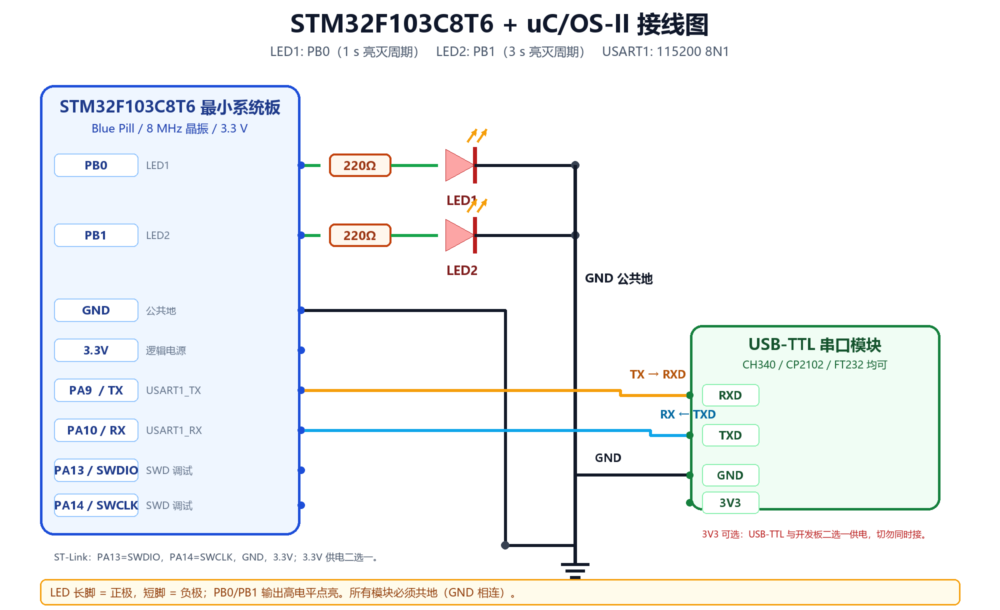

# 接线教程（实物）



本工程使用 **STM32F103C8T6 最小系统板（Blue Pill）**。LED 采用**高电平点亮**：
PB0/PB1 输出高电平时 LED 亮，输出低电平时 LED 灭。

---

## 1. 准备材料

| 材料 | 数量 | 说明 |
|---|---:|---|
| STM32F103C8T6 最小系统板 | 1 | Blue Pill，8 MHz 晶振 |
| LED | 2 | 红/绿/黄/蓝均可，建议 3 mm 或 5 mm |
| 电阻 | 2 | 220 Ω～330 Ω（红/绿/黄）；蓝/白可用 100～150 Ω |
| 面包板 | 1 | 或杜邦线直接连接 |
| 杜邦线 | 若干 | 公对公/公对母按板子接口选择 |
| USB-TTL 串口模块 | 1 | CH340、CP2102、FT232 均可，**3.3 V 逻辑** |
| ST-Link V2 | 1 | 下载/调试，SWD 接口 |
| USB 线 | 2 | 给 ST-Link 和 USB-TTL 供电/通信 |

> 不要用 LED 直接跨接在 GPIO 和 GND 之间，必须串电阻限流。
> 220 Ω 时电流约 5～7 mA，处于 STM32 GPIO 的安全范围。

---

## 2. 引脚分配

| STM32F103 引脚 | 连接到 | 方向 | 说明 |
|---|---|---|---|
| PB0 | 220 Ω -> LED1 正极 | 输出 | LED1，1 s 亮灭周期 |
| PB1 | 220 Ω -> LED2 正极 | 输出 | LED2，3 s 亮灭周期 |
| GND | LED1/LED2 负极、USB-TTL GND、ST-Link GND | — | 公共地 |
| PA9 | USB-TTL **RXD** | 输出 | USART1_TX |
| PA10 | USB-TTL **TXD** | 输入 | USART1_RX |
| 3.3V | ST-Link 3.3V 或 USB-TTL 3.3V（二选一） | 电源 | 不要同时接两个电源 |
| PA13 | ST-Link **SWDIO** | 双向 | 调试数据 |
| PA14 | ST-Link **SWCLK** | 输入 | 调试时钟 |

---

## 3. 接线步骤

### 第一步：接 LED1（PB0）

1. 认清 LED 极性：
   - **长脚 = 正极（阳极）**
   - **短脚 = 负极（阴极）**，LED 外壳扁平的一侧通常也是负极。
2. 把 220 Ω 电阻一端插到面包板，另一端用杜邦线接到开发板的 **PB0**。
3. 电阻的另一端接 LED1 的**长脚**。
4. LED1 的**短脚**接面包板的 GND 公共排。
5. 用杜邦线把开发板的 **GND** 接到同一排 GND。

```text
PB0 ──[ 220 Ω ]── LED1 长脚（+）── LED1 短脚（-）── GND
```

### 第二步：接 LED2（PB1）

重复第一步，把 PB0 换成 **PB1**，LED 换成 LED2：

```text
PB1 ──[ 220 Ω ]── LED2 长脚（+）── LED2 短脚（-）── GND
```

### 第三步：接 USB-TTL 串口

USB-TTL 的丝印通常是 `RXD`、`TXD`、`GND`、`3V3`（或 `5V`）。

| 开发板 | USB-TTL | 说明 |
|---|---|---|
| PA9（TX） | **RXD** | 开发板发，模块收 |
| PA10（RX） | **TXD** | 模块发，开发板收 |
| GND | GND | 必须共地 |

```text
PA9  (TX) ──────────► RXD
PA10 (RX) ◄────────── TXD
GND  ──────────────── GND
```

> 串口是“交叉连接”：TX 接对方 RX，RX 接对方 TX。
> 如果接成 TX-TX、RX-RX，收发都不通。

### 第四步：接 ST-Link（下载/调试）

| ST-Link | 开发板 |
|---|---|
| SWDIO | PA13 |
| SWCLK | PA14 |
| GND | GND |
| 3.3V | 3.3V（可选，见电源说明） |

```text
ST-Link SWDIO ────── PA13
ST-Link SWCLK ────── PA14
ST-Link GND   ────── GND
ST-Link 3.3V  ────── 3.3V（可选）
```

### 第五步：供电（重要）

三种供电方式**只能选一种**：

**方式 A：ST-Link 供电（推荐）**

- ST-Link 的 `3.3V` 接开发板 `3.3V`，`GND` 接 `GND`。
- ST-Link 插电脑 USB，开发板由 ST-Link 的 3.3V 供电。
- 此时 **不要**再接 USB-TTL 的 3.3V/5V。

**方式 B：USB-TTL 供电**

- USB-TTL 的 `3V3` 接开发板 `3.3V`，`GND` 接 `GND`。
- 此时 **不要**再接 ST-Link 的 3.3V，也不要插开发板的 USB。
- 注意：有些 USB-TTL 的 3V3 引脚输出电流较小（几十 mA），带 Blue Pill 可能不稳定；
  优先用 ST-Link 或开发板 USB 供电。

**方式 C：开发板 USB 供电**

- 开发板直接插 USB 线到电脑。
- 此时 USB-TTL 只接 `TX/RX/GND`，**不要**接它的 3.3V/5V。
- ST-Link 只接 `SWDIO/SWCLK/GND`，**不要**接 3.3V。

> **绝对不要**把 USB-TTL 的 5V 接到开发板的 3.3V 引脚。
> 也不要把两个电源的 3.3V 同时接在一起。

### 第六步：BOOT 跳线

Blue Pill 上的 `BOOT0` 跳线：

- 从 Flash 启动：`BOOT0 = 0`（跳到 GND）。
- 本工程用 ST-Link 下载，保持 `BOOT0=0` 即可。

如果误设成 `BOOT0=1`，复位后可能进入系统存储器启动，程序不运行。

---

## 4. 上电前检查

1. **不要通电**，先用万用表蜂鸣档检查：
   - 3.3V 与 GND 之间不能短路；
   - 5V 与 GND 之间不能短路；
   - LED 正负极不能直接跨在 3.3V/GND 上。
2. 检查 LED 极性：长脚接电阻，短脚接 GND。
3. 检查串口：PA9 接 RXD，PA10 接 TXD，GND 共地。
4. 检查 ST-Link：SWDIO=PA13，SWCLK=PA14，GND 共地。
5. 确认只接了一个电源。

---

## 5. 下载和运行

1. 打开 Keil 工程：
   `D:\Keil5\uCOSII_STM32F103\MDK-ARM\uCOSII_STM32F103.uvprojx`
2. `Project -> Options for Target -> Debug`，选择 `ST-Link Debugger`。
3. `Settings` 中确认能识别到 SWD 芯片；Flash 算法选 `STM32F10x_128`。
4. `Rebuild`（F7），确认 `0 Error(s), 0 Warning(s)`。
5. `Download`（F8），按开发板复位键。
6. 打开串口助手，选择 USB-TTL 对应的 COM 口，115200 8N1，UTF-8。
7. 观察：
   - LED1（PB0）每 0.5 s 翻转一次，完整周期 1 s；
   - LED2（PB1）每 1.5 s 翻转一次，完整周期 3 s；
   - 串口每 2 s 输出一行欢迎信息。

---

## 6. 用万用表/示波器验证

没有示波器也可以用万用表：

- PB0 对 GND：应在 0 V 和 3.3 V 之间交替，周期 1 s；万用表平均电压约 1.65 V。
- PB1 对 GND：应在 0 V 和 3.3 V 之间交替，周期 3 s；平均电压约 1.65 V。
- PA9 对 GND：空闲时应为高电平（约 3.3 V），发送时有快速跳变，万用表看不准，
  用示波器或逻辑分析仪更合适。

有示波器时：

```text
CH1: PB0，期望 1 Hz 方波，占空比 50%
CH2: PB1，期望 0.333 Hz 方波，占空比 50%
```

注意：`1 Hz` 对应 1 s 周期，`0.333 Hz` 对应 3 s 周期。

---

## 7. 常见接线错误

| 现象 | 可能原因 |
|---|---|
| 两个 LED 都不亮 | 开发板没供电、BOOT0=1、程序没下载成功、GND 没共地 |
| 只有一个 LED 亮/灭 | 另一个 LED 接反、电阻虚接、GPIO 焊点/杜邦线断 |
| LED 常亮不灭 | 任务没跑起来、PB0/PB1 被其他外设占用、程序卡在 HardFault |
| 串口无输出 | PA9/PA10 接反、USB-TTL 没装驱动、COM 口选错、没共地 |
| 串口乱码 | 波特率不是 115200、终端编码不是 UTF-8、USB-TTL 电平不匹配 |
| 下载失败 | ST-Link 驱动没装、SWDIO/SWCLK 接反、板子没供电、BOOT0 不对 |
| 一上电就发烫 | 电源短路、LED 没串电阻、5V 接到 3.3V |

更多排查见 [05_常见问题.md](05_常见问题.md)。
