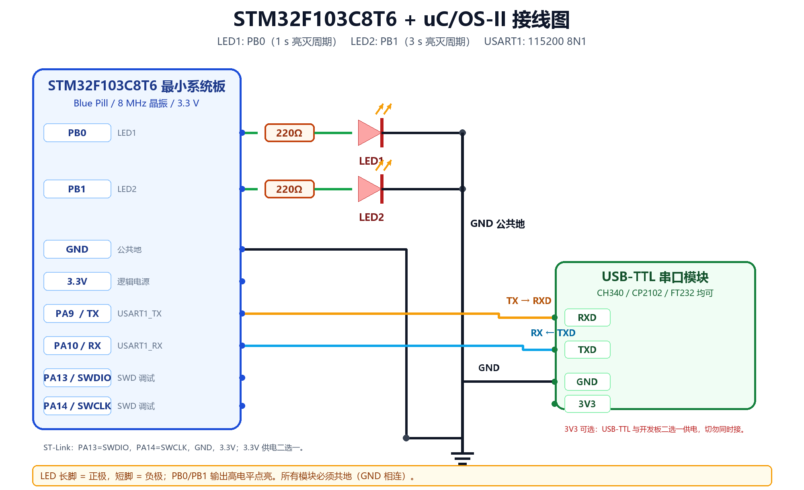

# STM32F103C8T6 + uC/OS-II 三任务实验

> 课程任务：学习嵌入式实时操作系统，以 uC/OS-II 为例移植到 STM32F103，创建 3 个任务：
> LED1（PB0）1 s 亮灭周期、LED2（PB1）3 s 亮灭周期、USART1 每 2 s 发送欢迎信息。

## 1. 项目位置与打开方式

- 工程根目录：`D:\Keil5\uCOSII_STM32F103`
- Keil 工程：`MDK-ARM\uCOSII_STM32F103.uvprojx`
- CubeMX 配置：`uCOSII_STM32F103.ioc`
- 芯片：`STM32F103C8T6`（LQFP48，20 KB RAM，64 KB Flash）
- 外部晶振：8 MHz；系统时钟：72 MHz
- 内核：uC/OS-II **V2.92.11**
- 移植层：Cortex-M3 / ARMCC（Keil MDK）
- 编译器验证：ARMCC V5.06 update 5，0 Error(s)，0 Warning(s)

打开 Keil 后直接 `Rebuild`（F7），然后 `Download`（F8）。下载前在
`Options for Target -> Debug` 中选择 **ST-Link Debugger**，在
`Utilities -> Settings` 中确认 Flash 算法为 `STM32F10x_128`。

## 2. 三个任务

| 任务 | 优先级 | 引脚/外设 | 周期 | 实现 |
|---|---:|---|---|---|
| Task1_LED1 | 4 | PB0，高电平点亮 | 1 s（亮 0.5 s + 灭 0.5 s） | `OSTimeDlyHMSM()` 阻塞延时 |
| Task2_LED2 | 5 | PB1，高电平点亮 | 3 s（亮 1.5 s + 灭 1.5 s） | `OSTimeDlyHMSM()` 阻塞延时 |
| Task3_UART | 6 | USART1，PA9/PA10，115200 8N1 | 2 s | 发送 UTF-8 字符串 |

串口发送内容（上电后立即发第一条，之后每 2 s 一条）：

```text
hello uc/OS! 欢迎来到RTOS多任务环境！
```

> 说明：本工程按“**完整亮灭周期**”实现，即 LED1 亮 0.5 s、灭 0.5 s 为一个 1 s 周期；
> LED2 亮 1.5 s、灭 1.5 s 为一个 3 s 周期。若老师把“1 s 任务”定义为“每 1 s 翻转一次”，
> 把 `Core/Src/app_tasks.c` 中的 `LED1_HALF_PERIOD_MS` 改为 `1000`、
> `LED2_HALF_PERIOD_SEC/MS` 改为 `3/0` 即可，此时完整周期变为 2 s/6 s。

## 3. 接线总览



详细步骤见 [Doc/04_接线教程.md](Doc/04_接线教程.md)。核心连接：

| STM32F103 | 连接到 | 说明 |
|---|---|---|
| PB0 | 220 Ω -> LED1 长脚（正极），LED1 短脚 -> GND | 高电平点亮 |
| PB1 | 220 Ω -> LED2 长脚（正极），LED2 短脚 -> GND | 高电平点亮 |
| PA9（USART1_TX） | USB-TTL 的 **RXD** | TX 接对方 RX，交叉连接 |
| PA10（USART1_RX） | USB-TTL 的 **TXD** | RX 接对方 TX |
| GND | USB-TTL GND、ST-Link GND | 必须共地 |
| 3.3V | ST-Link 3.3V 或 USB-TTL 3.3V（二选一） | 不要同时用两个电源 |
| PA13 | ST-Link SWDIO | 下载/调试 |
| PA14 | ST-Link SWCLK | 下载/调试 |

> LED 必须串联限流电阻（220 Ω～330 Ω），不能把 LED 直接跨在 PB0 和 GND 之间。
> LED 长脚是正极，短脚是负极；接反不会亮。

## 4. CubeMX 配置

`.ioc` 文件已经包含以下配置，可直接用 STM32CubeMX 6.17 打开查看：

| 项目 | 配置 |
|---|---|
| RCC | HSE：Crystal/Ceramic Resonator，8 MHz |
| SYS | Debug：Serial Wire；Timebase：SysTick |
| Clock | PLL x9，SYSCLK/AHB/APB2 = 72 MHz，APB1 = 36 MHz，Flash latency 2 |
| GPIO | PB0、PB1：GPIO_Output，Push-Pull，No Pull，Low Speed，初始低电平 |
| USART1 | Asynchronous，115200，8 Data bits，1 Stop bit，No Parity，No Flow Control |
| USART1 引脚 | PA9 = TX（AF Push-Pull），PA10 = RX（Input Pull-up） |
| NVIC | Priority Group 4；SysTick 和 PendSV 均为最低优先级 15 |
| Toolchain | MDK-ARM V5 |

完整截图式配置说明见 [Doc/02_CubeMX配置.md](Doc/02_CubeMX配置.md)。

> **重要**：CubeMX 只负责生成 HAL 硬件初始化骨架。uC/OS-II 内核、移植层、
> 任务代码和 Keil 分组是手工加入的。若在 CubeMX 中再次点击 `GENERATE CODE`，
> 可能覆盖 `Core/Src/main.c`、`Core/Src/stm32f1xx_it.c` 等文件。重新生成前请先备份
> `Core`、`Middlewares`、`MDK-ARM` 三个目录。

## 5. 目录结构

```text
uCOSII_STM32F103/
├─ Core/
│  ├─ Inc/                  main.h、gpio.h、usart.h、bsp_led.h、app_tasks.h
│  └─ Src/                  main.c、gpio.c、usart.c、app_tasks.c、bsp_led.c、
│                           stm32f1xx_it.c、stm32f1xx_hal_msp.c、system_stm32f1xx.c
├─ Drivers/                 STM32F1xx HAL + CMSIS
├─ Middlewares/Third_Party/uC-OS2/
│  ├─ Source/               uC/OS-II V2.92.11 内核源码
│  ├─ Cfg/                  os_cfg.h、app_cfg.h
│  └─ Ports/ARM-Cortex-M3/RealView/
│                           os_cpu.h、os_cpu_a.asm、os_cpu_c.c
├─ MDK-ARM/
│  ├─ startup_stm32f103xb.s
│  ├─ uCOSII_STM32F103.uvprojx
│  └─ Objects/              编译输出（hex/axf/map）
├─ Doc/                     移植过程、CubeMX 配置、接线教程、任务说明
├─ uCOSII_STM32F103.ioc
└─ README.md
```

## 6. 文档索引

1. [Doc/01_移植过程详解.md](Doc/01_移植过程详解.md) —— 从 CubeMX 工程到 uC/OS-II 跑起来的完整步骤
2. [Doc/02_CubeMX配置.md](Doc/02_CubeMX配置.md) —— 引脚、时钟、NVIC、USART、工程参数
3. [Doc/03_任务设计与实验现象.md](Doc/03_任务设计与实验现象.md) —— 三个任务、时序、串口输出
4. [Doc/04_接线教程.md](Doc/04_接线教程.md) —— 实物接线、电源、ST-Link、串口模块
5. [Doc/05_常见问题.md](Doc/05_常见问题.md) —— 编译、下载、HardFault、串口乱码排查

## 7. 编译结果

本工程在 Keil MDK 5.24a + ARMCC 5.06 update 5 下编译通过：

```text
Program Size: Code=6684 RO-data=616 RW-data=60 ZI-data=6044
".\Objects\uCOSII_STM32F103.axf" - 0 Error(s), 0 Warning(s).
```

已确认启动向量表：

- `PendSV_Handler` = `OS_CPU_PendSVHandler`，位于向量表偏移 `0x38`
- `SysTick_Handler` 位于向量表偏移 `0x3C`，内部调用 `HAL_IncTick()` 和 `OS_CPU_SysTickHandler()`

## 8. 许可说明

uC/OS-II 源码版权归 Micrium/Jean J. Labrosse 所有。Micrium 的授权条款允许用于
短期评估、教学和和平研究；商业产品需要另行取得授权。本工程仅用于课程学习，
请勿直接用于商业产品。原始版权头保留在 `Middlewares/Third_Party/uC-OS2` 中。

## 9. 已验证环境

- Windows 10/11
- Keil MDK-ARM 5.24a，ARMCC 5.06 update 5
- Keil STM32F1xx_DFP 2.2.0
- STM32CubeMX 6.17.0（`.ioc` 由该版本格式生成）
- STM32Cube FW_F1 V1.8.7 HAL 驱动
